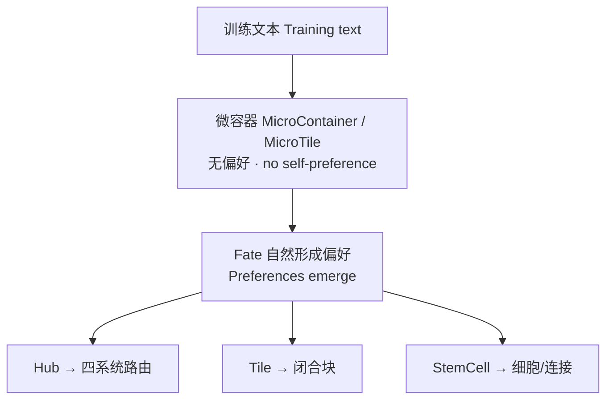

# Hub · Tile · StemCell — 自然逻辑与训练文本自动聚合

**Natural Logic & Training-Text Auto-Aggregation**

**出品 / By**: Rogue Intelligence LNC.  
**测试日期 / Test date**: 2026-06-05  
**测试策略 / Strategy**: 轻量 smoke（验证预期行为）+ 本地对话语料短跑（完整管线可完成）

---

## 共同设计原则 / Shared Design Principles

| 中文 | English |
|------|---------|
| **无内部分工预设**：四元系统（BlackHole / MeshBrain / MultiNova / BaseForce）不硬编码「谁做语言、谁做视觉」。 | **No preset internal roles**: the four quad-systems are not hard-coded for language vs. vision, etc. |
| **微容器无自决收敛**：MicroContainer / MicroTile 只收集统计，**不**自行决定何时闭合。 | **Micro-containers do not self-close**: they collect stats only; closure is **not** decided locally. |
| **偏好自然形成**：Fate（TripleFate）根据边际效应与反馈，在探索（轮询）与收敛（偏好路由）之间切换。 | **Preferences emerge**: Fate switches between exploration (round-robin) and convergence (preference routing) from feedback. |
| **训练文本自动聚合**：多语言句子、对话、词汇等以字符/信号流输入，系统自动路由或凝结为 Tile/细胞结构，**无需人工标签分工**。 | **Training text auto-aggregates**: multilingual text flows in as signals; routing and structures form **without manual role labels**. |



---

## 1. Hub（valhalla-f64）— AI 中枢路由

### 中文介绍

**Hub** 是 Valhalla 的 **多模态调度中枢**：训练文本（及代码、语法模式等）被转为 **DeformationSignal**，经 **Fate-f64** 协调后路由到四元系统之一。

- **探索期**：Fate 尚未收敛时，采用 **轮询（Round-Robin）**，四系统均分信号，避免人为偏置。  
- **收敛期**：Fate 检测到 `converging` / `fixed_point` 后，由 **偏好权重** 决定主路由目标。  
- **聚合含义**：不同来源的文本（对话、UD 词形、词汇表）在同一 Hub 内被 **统一计数、分源统计、分系统追踪**，形成可审计的「数据流向报告」。

**路径**：`manifestsys/hub-f64/` · 聚合分析：`valhalla_aggregation_analysis`

### English Introduction

**Hub** is Valhalla’s **multimodal routing center**. Training text (plus code, grammar patterns, etc.) becomes **DeformationSignal** streams, coordinated by **Fate-f64** and routed to one of four quad-systems.

- **Exploration**: before Fate converges, **round-robin** keeps all four systems fed—no baked-in bias.  
- **Convergence**: after `converging` / `fixed_point`, routing follows **learned preference weights**.  
- **Aggregation**: mixed text sources are **unified, counted, and traced per system** in an auditable flow report.

**Paths**: `manifestsys/hub-f64/` · aggregation bin: `valhalla_aggregation_analysis`

### 测试结果 / Test Results

#### A. 轻量 Smoke（`valhalla_text_aggregation_smoke`）

| 指标 | 结果 | 预期行为 |
|------|------|----------|
| 输入 | 10 条多语言短句（内嵌语料） | 文本 → 信号 |
| 信号数 | **206** | > 0 ✓ |
| 路由分布 | BH **51** / MB **52** / MN **52** / BF **51** | 近似均分（探索轮询）✓ |
| 判定 | **PASS** | Hub 可完成路由与 Fate 反馈 |

#### B. 本地语料聚合（`valhalla_aggregation_analysis`，~0.03s）

| 指标 | 结果 |
|------|------|
| 总信号 | **98,891**（字符级） |
| 来源 | 对话 89.3%、代码 6.5%、语法 2.4%、数学 1.7% |
| 语言 | English 46.9%、Chinese 30.0% 等 9 种 |
| 路由分布 | MultiNova **66.0%**、其余三系统各 **~11.3%** |
| Fate 状态 | 振荡 diverging/converging；最终偏好 MN **66.37%** |
| 聚合结论 | 对话文本主导；**偏好由数据+Fate 自然涌现**（非预设 MN 负责语言） |

**复现 / Reproduce**:

```bash
cd Valhalla
RUSTFLAGS='-L /opt/cuda/lib64' cargo run --release -p hub-f64 --bin valhalla_text_aggregation_smoke
./target/release/valhalla_aggregation_analysis   # 需本地 manifestsys/hub/data 与对话文件
```

---

## 2. Tile（TileQuattroComplete）— 方块化文本聚合

### 中文介绍

**Tile** 取义 **俄罗斯方块（Tetris）**：训练文本以标量/字符流进入 **MicroTile**，在局部环形缓冲中累积统计；当 **Fate** 判定边际效应递减时，MicroTile **闭合** 为 CompletedTile，参与合并、分裂与空间维度调整。

- **无预设块类型**：块何时闭合、如何合并，由 Fate + ClusterEquation 驱动。  
- **文本聚合**：多条对话/句子不再以「文件」形式保留，而凝结为 **有限数量的 Tile 块**（均值、方差、签名），类似把散乱文本 **嵌入、消行、重组** 为紧凑块。  
- **与 Hub 关系**：**并列产品线**，可独立运行，不必经过 Hub。

**路径**：`manifestsys/tile-quattro/src/tile_complete.rs`

### English Introduction

**Tile** uses a **Tetris metaphor**: training text enters **MicroTile** ring buffers; when **Fate** sees diminishing marginal effect, tiles **close** into CompletedTiles and then merge, split, and reshape space dimension.

- **No preset block types**: closure and merge timing are Fate-driven.  
- **Text aggregation**: many lines collapse into **a small set of tiles** (mean, variance, signature)—scattered text **packed into compact blocks**.  
- **vs. Hub**: **standalone** product line; no Hub dependency.

### 测试结果 / Test Results

#### A. 轻量 Smoke（同上脚本）

| 指标 | 结果 | 预期行为 |
|------|------|----------|
| 输入 | 10 条内嵌多语言短句 | 文本 → 标量/字符信号 |
| 闭合 Tile | **3** | > 0 ✓ |
| 操作数 | **4** | 发生闭合/处理 ✓ |
| 空间维度 | **4.00** | 维度可计算 ✓ |
| 判定 | **PASS** | Tile 可完成文本→块聚合 |

#### B. 对话语料短跑（`valhalla_tile_test`，1308 条，~0.2s）

| 指标 | 结果 |
|------|------|
| 语料 | 本地对话 **1308** 条（无外挂磁盘语料） |
| 周期 1 | 原始数据 → **20** 个 Tile |
| 周期 2–10 | 合并/分裂持续；Tile 数稳定在 **20** |
| Fate | 10 周期内未触发收敛（继续演化，符合设计） |
| 聚合结论 | 1308 条对话 **自动凝结为 20 个 Tile 块** |

**复现 / Reproduce**:

```bash
RUSTFLAGS='-L /opt/cuda/lib64' cargo run --release -p hub-f64 --bin valhalla_text_aggregation_smoke
./target/release/valhalla_tile_test
```

---

## 3. StemCell（StemCellComplete）— 自然神经网形成

### 中文介绍

**StemCell** 取义 **生物学干细胞**：训练文本流进入 **MicroContainer**，闭合为 **Cell**（带数据签名与空间坐标）；细胞间通过 **签名相似度 + 物理场** 产生吸引/排斥，**连接自然涌现**，而非预设层数或反向传播栈。

- **无组织类型预设**：`TissueLayer::Undetermined`；不强制「感觉层/运动层」分工。  
- **文本聚合**：字符流 → 细胞群 → 合并（相似签名）/ 分裂（Fate 周期）→ 高维空间中的 **自组织网络拓扑**。  
- **空闲演化**：无新输入时 `evolve(0.0)` 仍可重组连接（见 `reports/STEMCELL_SPONTANEOUS_BEHAVIOR_EXPERIMENT.md`）。

**路径**：`manifestsys/stem-cell/src/stemcell_complete.rs`

### English Introduction

**StemCell** follows **stem-cell biology**: text streams fill **MicroContainers**, close into **Cells** (signature + position); **connections emerge** from signature similarity and a physics field—not fixed layers or backprop stacks.

- **No tissue presets**: `TissueLayer::Undetermined`; no forced sensory/motor split.  
- **Text aggregation**: character streams → cell population → merge/split cycles → **self-organized graph** in high-dimensional space.  
- **Idle evolution**: `evolve(0.0)` can reorganize without new input.

### 测试结果 / Test Results

#### A. 轻量 Smoke（同上脚本）

| 指标 | 结果 | 预期行为 |
|------|------|----------|
| 输入 | 10 条内嵌多语言短句 | 字符 → 归一化标量 |
| 细胞数 | **108** | > 0 ✓ |
| 空间维度 | **30.94** | 维度随结构增长 ✓ |
| 判定 | **PASS** | StemCell 可完成文本→细胞聚合 |

#### B. 对话语料短跑（`valhalla_stemcell_test`，1279 条，~0.2s）

| 指标 | 结果 |
|------|------|
| 语料 | 本地对话 **1279** 条 |
| 周期 1 | **82,176** 信号 → **7,130** 细胞 |
| 周期 10 | **5,677** 细胞（合并累计 **1,453** 次，分裂 **100** 次） |
| 空间维度 | **1802.63** |
| Fate | 10 周期内未收敛（结构仍在压缩合并） |
| 聚合结论 | 对话文本 **自动形成数千细胞并自发合并**；网络拓扑由 Fate 周期驱动 |

**复现 / Reproduce**:

```bash
RUSTFLAGS='-L /opt/cuda/lib64' cargo run --release -p hub-f64 --bin valhalla_text_aggregation_smoke
./target/release/valhalla_stemcell_test
```

---

## 4. 三者对比 / Side-by-Side Comparison

| 维度 / Dimension | Hub | Tile | StemCell |
|------------------|-----|------|----------|
| **聚合单元 / Unit** | 四系统路由计数 | CompletedTile 块 | Cell + 连接 |
| **文本入口 / Input** | 字符 → HubRequest | 长度/字符标量 | 字符归一化标量 |
| **无预设分工 / No preset roles** | 轮询 → Fate 偏好 | Fate 闭合块 | Undetermined 组织层 |
| **Smoke 判定** | **PASS** | **PASS** | **PASS** |
| **语料短跑** | 98,891 信号聚合报告 | 1308 条 → 20 Tile | 1279 条 → 5677 细胞 |
| **Fair 多轮 cycle (20260620)** | — | patch **c1≡c20** · QA +0 pp | patch **变** · QA +0.69 pp |
| **独立性 / Standalone** | 可单独演示 | 可单独运行 | 可单独运行 |

### 4.1 Fair Benchmark 多轮 Cycle 实验（20260620）

在 **ingest_clean 49 行** + **test 145Q** 上，对 Tile / StemCell 分别测试 cycle 1/5/10/20：

| 指标 | Tile | StemCell |
|------|------|----------|
| 结构 | 177 tiles，patch_hash **不变** | 277 stem，patch_hash **随 cycle 变** |
| QA (isolated) | 34.5% → 34.5% | 34.5% → 35.2% |
| 对照 triad persistent | 40.7%（+6.2 pp） | 同左 |
| 对照 Tier A patch | 68–69% | 69.0% |

**机制**：`run_optimize_cycles` 在 `has_fate_converged()` 时早停（Tile 第 1 轮即停）；StemCell `evolve` 改写 patch 但 Tier B 解码读离散签名 → QA 平台。

详版：`reports/VALHALLA_TILE_STEMCELL_MULTI_CYCLE_EXPERIMENT_20260620.md` · 演示仓 `valhalla-transformer/zh/11_TILE_STEMCELL_CYCLE_EXPERIMENT.md`

**复现**：

```bash
python3 tools/fair_benchmark/run_tile_stemcell_cycle_experiment.py \
  --phase test --protocols export,isolated \
  --artifact checkpoints/incubation_artifacts/fair_triad_c1/
```

---

## 5. 预期行为核对清单 / Expected-Behavior Checklist

| # | 预期 / Expected | Hub | Tile | StemCell |
|---|-----------------|-----|------|----------|
| 1 | 训练文本可输入并产生内部状态 | ✓ | ✓ | ✓ |
| 2 | 微容器不自行决定收敛 | ✓ | ✓ | ✓ |
| 3 | 结构/路由/偏好由 Fate 驱动 | ✓ | ✓ | ✓ |
| 4 | 无硬编码四系统分工 | ✓（轮询期均分） | ✓ | ✓ |
| 5 | 多语言文本可同一管线处理 | ✓ | ✓ | ✓ |
| 6 | 自动聚合（非人工分桶） | ✓ 分系统统计 | ✓ 凝结为 Tile | ✓ 凝结为细胞 |

---

## 6. 说明 / Notes

- **轻量 smoke** 用于门禁：确认三者均可完成「文本进 → 结构出」闭环；完整 10 周期 Fate 训练可在语料充足时另行长跑。  
- **Hub 聚合报告** 依赖 `manifestsys/hub/data/`（UD、词汇、代码样本）及仓库根目录对话 `.txt`；外挂语料盘不可用时，对话+本地数据仍可跑通。  
- **GPU/CUDA**：`hub-f64` 链接需 `RUSTFLAGS='-L /opt/cuda/lib64'`（或本机 CUDA 库路径）。  
- 三者 **不强制联用**；Hub、Tile、StemCell 为 Valhalla 内 **并列** AI 自然逻辑方案。

---

*Rogue Intelligence LNC. · Valhalla · 2026-06-20*
