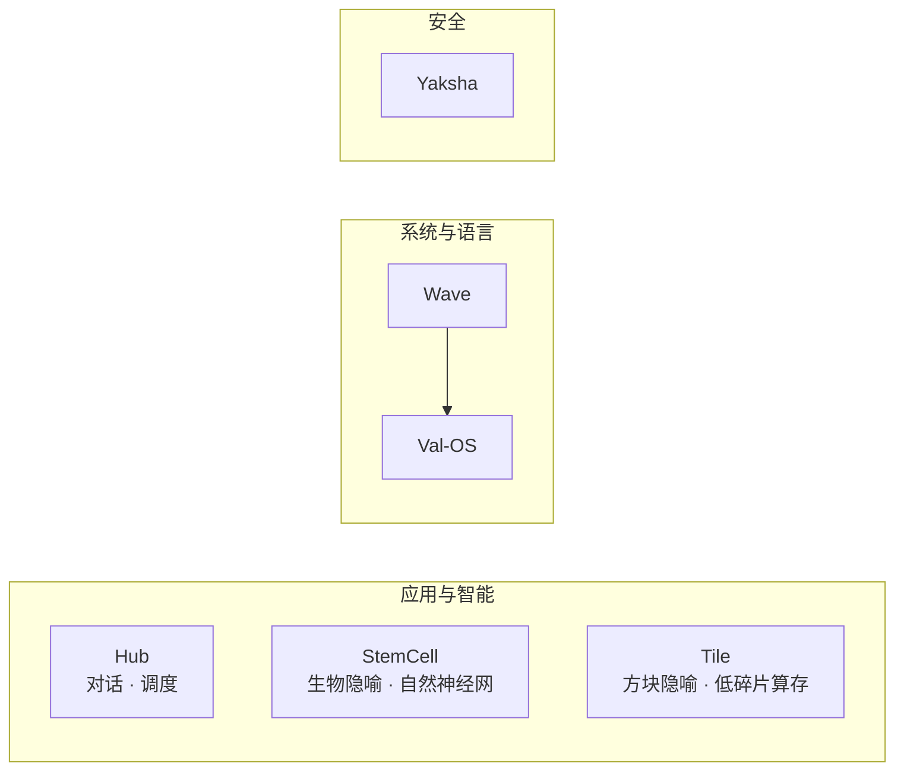

# Valhalla — 天使 / YC 融资文稿

**公司**：Rogue Intelligence LNC（游侠智能有限公司）  
**阶段**：种子 / Pre-seed（产品可演示，商业化早期）  
**文稿用途**：天使会议纪要、YC 申请表填空、2 分钟 Demo Day 提纲  
**更新**：2026-06（结合 [YC 2026 申请要点](https://rizevault.razorpay.com/p/y-combinator-prep-faq-bank-2026-guide)、[2026 AI 投资趋势](https://www.getdecko.com/blog/what-investors-want-in-a-pitch-deck-in-2026-and-whats-changed) 整理）

---

## 0. 一句话（YC「What does your company do?」）

**中文**：Rogue Intelligence 用自研 **Wave 语言 + Val-OS** 做可私有化部署的 **AI 运行时栈**；在应用层用 **Hub** 做可控对话与调度，用 **干细胞 / Tile** 两条独立路线探索 **非强制深度学习** 的结构化智能，并用 **夜叉** 提供可验证的数据保护。

**English (≤50 words)**：  
Rogue Intelligence builds a sovereign AI stack: Wave (rule-driven language), Val-OS (bootable OS), Hub (routing AI runtime), plus StemCell and Tile for self-organizing intelligence without default deep-learning training—and Yaksha for auditable encryption.

---

## 1. 我们在解决什么问题

### 1.1 痛点（1–2 句）

企业在做 **垂直 AI** 和 **私有化部署** 时，往往被两类成本困住：

1. **算力与推理税**：长期依赖闭源 API，单位经济难以成立（2026 年投资人普遍要求可解释的 inference 成本路径）。  
2. **黑箱与不可控**：通用大模型难以沉淀行业结构、难以审计路由与数据路径。

### 1.2 谁最痛

| 客户画像 | 急性场景 |
|----------|----------|
| **政企 / 关基 / 制造** | 需要本地或专有云 AI，不能接受数据出境与不可审计路由 |
| **垂直 SaaS / 工业软件** | 需要「越用越成结构」的领域知识，而非每次 prompt 工程 |
| **教育 / 实验室** | 需要 **从语言到操作系统** 的可演示全栈，而非 PPT 型「AI 概念」 |

### 1.3 为什么是现在（Why now）

结合 2026 年市场与政策环境（公开信息归纳）：

| 信号 | 对我们的含义 |
|------|----------------|
| 资本从「纯概念 AI」转向 **可验证基础设施与单位经济** | 我们有 **可运行 OS、可测加密门禁、可演示 Hub**，不是幻灯片 |
| 推理成本与 **数据主权** 成为采购硬条件 | **Wave + Val-OS + 夜叉** 讲「全栈可控」故事 |
| YC / 主流基金关注 **inference infra、vertical agents、devtools** | 我们定位 **infra + vertical runtime**，而非又一个 Chat 套壳 |

---

## 2. 我们的答案（不暴露核心算法）

### 2.1 产品地图（四条独立线，可拆卖）

| 产品线 | 对外定义 | 与竞品差异（一句话） |
|--------|----------|----------------------|
| **Hub** | AI 中枢：多模态接入、智能路由、状态延续 | **可控、可观测** 的专用 runtime，非通用聊天 API |
| **StemCell** | 生物学隐喻：细胞分裂/特化，结构自组织 | **自然神经网络形成**，默认路径 **不是** 堆叠反向传播大模型 |
| **Tile** | 俄罗斯方块隐喻：方块化嵌入与重组 | **低碎片** 内存/并行块管理，可进 OS 或独立交付 |
| **Wave** | 规则驱动语言；语法简单；规则层可映射 GPU | **低级规则 → 高级语义**，一门语言贯通应用与系统 |
| **wave-bin** | Wave 工具链 **一分支**（裸机/引导） | 编译器约 **8 KB** 级，服务 Val-OS 引导 |
| **Val-OS** | Wave 原生 OS，虚拟机已跑通 | **语言即系统**，加分屏/多屏显示方案 |
| **Yaksha** | 加密与认证（可选） | 有 **行业 benchmark 门禁**（见 §4） |

**重要**：Hub、StemCell、Tile **不强绑定**——客户可按场景只买其一；降低集成风险，也降低「全栈必须一起上」的销售阻力。

### 2.2 核心洞察（What's new）

1. **范式**：在「必须预训练 100B」之外，提供 **结构生长式** 智能路径（StemCell + Tile）。  
2. **栈**：用 **同一门 Wave** 覆盖应用与 **Val-OS**，缩短从 demo 到可部署设备的路径。  
3. **可信**：夜叉走 **可复现 benchmark**；Hub 走 **可加载训练状态** 的演示（见 §4）。

---

## 3. 商业模式（2026 投资人会追问）

| 收入线 | 目标客户 | 计费逻辑（草案） |
|--------|----------|------------------|
| **Hub 企业版** | 垂直行业、研究所 | 私有化部署 + 年维保；按接入模态/通道数 |
| **StemCell / Tile 模块** | 有长周期数据资产的客户 | 模块授权 + 实施；按节点或数据规模 |
| **Val-OS + Wave 栈** | 教育、工控、展陈、国产化试点 | 镜像/OEM 授权 + 定制驱动 |
| **Yaksha** | 需要合规传输的客户 | 按核心或实例授权；可与 Hub 捆绑 |

**单位经济（诚实口径）**：当前 **尚无规模化 MRR**；融资后 12 个月内目标为 **2–3 个付费试点（POC→合同）**，主指标为 **私有化 Hub 部署数** 与 **Val-OS 镜像出货/试点数**，而非虚报 ARR。

**毛利路径**：推理若走本地栈，避免持续 API 抽成；夜叉与 OS 为 **软件毛利** 结构，需用试点验证实施成本。

---

## 4. 进展与证据（Traction — 用事实说话）

> YC / 天使在 2026 年普遍要求：**能演示、能复测、能解释弱项**（参见 [TechCrunch × Dalton Caldwell](https://techcrunch.com/2022/04/27/how-to-get-into-y-combinator-dalton-caldwell/)：清晰、无 buzzword、承认 hard question）。

### 4.1 产品就绪度

| 里程碑 | 状态 | 证据类型 |
|--------|------|----------|
| Hub 交互对话 | 可演示 | CLI 可启动；可加载历史训练统计（例：67 万+ 信号规模级 checkpoint） |
| Val-OS 虚拟机 | 已跑通 | QEMU 可启动；登录/桌面/多应用；镜像可生成 |
| Wave 应用编译 | 可演示 | `hello.wave` → ELF 运行 |
| StemCell / Tile | 工程集成 | 独立 crate，可单独试验 |
| 夜叉 | 门禁通过 | 见下表 |

### 4.2 可复测 benchmark（对外可出示目录，不公开实现）

**夜叉（Yaksha）** — `external_bench/run_all.sh`，2026-06-04，CPU：

| 指标 | 结果 |
|------|------|
| 功能 smoke | 通过 |
| AEAD 16 MB 吞吐 | seal **83 MB/s**，open **77 MB/s** |
| dieharder STS（d100–102） | **全部 PASSED** |

**Wave / wave-bin** — `wave/bench/run_cross_language.sh`，2026-06：

| 指标 | 结果 |
|------|------|
| wave-bin 编译器 | **8192 B** |
| 同 workload ELF 体积 | **357 B** vs C **15 976 B** |
| C 耗时（10M 次循环） | **0.018 s** vs Python **3.7 s** |

*说明：wave-bin 该行 workload 的循环语义随工具链演进；向投资人强调 **体积与可引导部署**，而非宣称全面超越 gcc。*

### 4.3 我们尚未声称的（面试时主动说）

- **无** 大规模付费客户与周环比增长 MRR（YC 最看重指标之一）。  
- Hub **不是** GPT-4 级通用对话产品；强项是 **路由、沉淀、私有化**。  
- StemCell / Tile **未** 在公开榜单上对标 SOTA 大模型；路径是 **结构智能 + 行业 POC**。  
- hub-f64 GPU 训练链依赖 CUDA 环境，需工程化降低部署摩擦。

---

## 5. 市场与竞争（SOM 优先，避免 inflated TAM）

### 5.1 可先拿下的市场（SOM）

| 细分 | 规模直觉 | 我们切入点 |
|------|----------|------------|
| 中国区 **私有化 AI 试点**（政企、园区、科研） | 数千级意向客户 | Hub + 夜叉 + 本地部署故事 |
| **职业教育 / 实验室 OS** | 数百所高校实训更新周期 | Val-OS 虚拟机 + Wave 教学 |
| **工业软件嵌入式智能** | 按项目制 | Tile + StemCell 模块 |

### 5.2 竞争格局（诚实矩阵）

| 对手类型 | 他们强在哪 | 我们强在哪 |
|----------|------------|------------|
| OpenAI / 闭源 API | 通用能力 | **主权、可审计、无持续 API 税** |
| LLM 套壳 SaaS | 上线快 | **自研栈 + 非默认深度学习路径** |
| 传统 OS + Linux AI | 生态成熟 | **Wave 一体 + Val-OS 演示 + 方块化内存叙事** |
| 纯加密厂商 | 成熟合规 | **与 AI 栈原生组合的可测门禁** |

**护城河表述（2026 风格）**：不强调「秘密公式」，强调 **(1) 全栈可复制交付 (2) benchmark 与镜像 (3) 模块化合同 (4) 创始人持续迭代同一仓库多年**。

---

## 6. 团队（YC 最看重 — 请创始人补全）

> YC 投资 **founders > idea**；请在本节填入真实信息后再发出。

| 角色 | 姓名 | 相关度证明（示例项） |
|------|------|----------------------|
| CEO / 技术愿景 | *待填* | 主导 Wave / Val-OS / Valhalla 多年迭代；可现场演示 |
| 工程 | *待填* | Rust 系统、编译器、OS 镜像生成 |
| 商业 | *待填* | 政企/渠道/试点客户触达 |

**创始人–市场匹配（-founder-market fit）建议叙述**：  
*「我们长期做系统级软件（语言 + OS + AI runtime），客户痛点来自私有化与可控性，而非我们追逐热点模型榜单。」*

---

## 7. 融资需求

| 项目 | 建议 |
|------|------|
| **轮次** | 种子 / Pre-seed |
| **金额** | *待填*（示例区间：USD 500K–1.5M 或 RMB 等值） |
| ** runway** | 12–18 个月 |
| **用途** | 40% 工程（Hub 产品化、Val-OS 硬件适配）/ 30% 试点交付 / 20% benchmark 与合规 / 10% 运营 |

### 12 个月里程碑（可检验）

1. **3 个** 付费或强 LOI 试点（Hub 私有化或 Val-OS 镜像）。  
2. Hub **周活跃部署** 达 *N*（由试点定义，写入合同）。  
3. 夜叉 + Wave **第三方复测报告** 各 1 份（便于政企采购）。  
4. StemCell 或 Tile **单模块** 在一个垂直场景完成端到端案例（医疗/制造/教育择一）。

---

## 8. YC 申请表 — 可直接粘贴（英文）

*按 [YC 常见题序](https://pitchgrade.com/blog/y-combinator-application-guide) 整理；提交前请替换 `[]` 内容。*

**What is your company going to make?**  
Rogue Intelligence is building a deployable AI stack: Wave, a simple rule-driven language that compiles to native code and maps rules to GPU parallelism; Val-OS, a Wave-native OS we boot in QEMU today; Hub, a routing-centric AI runtime for dialogue and multimodal ingestion; StemCell and Tile as separate engines for self-organizing structure (biology and Tetris metaphors) without default large-scale backprop training; and Yaksha, encryption with reproducible industry benchmarks.

**Why did you pick this idea?**  
`[Founder story: e.g. years building full stack, saw customers fail on API lock-in and black-box routing.]`

**What's new about what you're making?**  
We ship a full stack (language → OS → runtime → optional crypto) that customers can own. Hub, StemCell, and Tile are intentionally decoupled products. We focus on verifiable demos and benchmarks, not wrapper APIs.

**Who are your competitors?**  
Closed API providers, LLM wrappers, and generic Linux+GPU stacks. We win on sovereignty, modularity, and an alternative intelligence path beyond default deep learning.

**How do you make money?**  
Enterprise licenses for Hub and modules; Val-OS/Wave OEM for education and edge devices; Yaksha licensing bundled with private deployments.

**How far along are you?**  
Hub CLI demo works with loaded training state; Val-OS boots in VM; Wave compiles and runs hello; Yaksha passes our external_bench CPU gate (AEAD ~83 MB/s at 16MB, STS dieharder passed); wave-bin compiler is 8KB. Pre-revenue; seeking pilot customers.

**Why now?**  
2026 buyers demand proof and unit economics; inference cost and data sovereignty are procurement requirements. We already have runnable artifacts, not slides.

**What do you understand about your business that others don't?**  
Vertical AI needs observable routing and owned infrastructure; structure-growing intelligence can complement monolithic pretrained models for long-horizon domain data.

---

## 9. 天使 30 秒口播 + 2 分钟结构

### 30 秒

「Rogue Intelligence 做可私有化部署的 AI 全栈：自研 Wave 语言和能启动的 Val-OS，加上 Hub 做可控 AI 调度。干细胞和 Tile 是两条独立路线，用生物学和俄罗斯方块的隐喻，探索不依赖强制深度学习训练的结构智能。夜叉提供可复测加密。我们能演示虚拟机、对话系统和 benchmark，正在找种子轮打政企和垂直行业的试点。」

### 2 分钟（Demo Day 提纲）

| 时间 | 内容 |
|------|------|
| 0:00–0:20 | 问题：API 税 + 黑箱 |
| 0:20–0:50 | 方案：四条产品线 + 全栈图 |
| 0:50–1:20 | 演示：Val-OS 启动 / Hub 对话 / benchmark 一页 |
| 1:20–1:40 | 商业：私有化授权 + 试点指标 |
| 1:40–2:00 | 团队 + Ask |

---

## 10. 投资人可能问的 hard questions（建议坦诚答复）

| 问题 | 建议答复方向 |
|------|----------------|
| 你们和 OpenAI 比？ | 不做通用智商对标；做 **可控私有化 runtime** |
| 为什么没收入？ | 前期全栈研发；本轮换 **试点与合同** |
| StemCell 科学吗？ | **工程范式** + POC，不声称已超越 SOTA LLM |
| 为什么需要 OS？ | 交付与叙事：客户要 **可启动、可审计** 的实体，不仅是 Python 包 |
| 8KB 编译器可信吗？ | 展示 **wave-bin 构建产物 + 镜像启动**；承认应用层仍随 wavec 演进 |

---

## 11. 附录

- **Valhalla 技术白皮书**：[`docs/whitepapers/VALHALLA_TECHNICAL_WHITEPAPER.md`](./whitepapers/VALHALLA_TECHNICAL_WHITEPAPER.md)  
- **Wave 技术白皮书**：[`docs/whitepapers/WAVE_TECHNICAL_WHITEPAPER.md`](./whitepapers/WAVE_TECHNICAL_WHITEPAPER.md)  
- **夜叉 Yaksha 技术白皮书**：[`docs/whitepapers/YAKSHA_TECHNICAL_WHITEPAPER.md`](./whitepapers/YAKSHA_TECHNICAL_WHITEPAPER.md)  
- **Valhalla 产品定义 PD**：[`docs/VALHALLA_PRODUCT_DEFINITION.md`](./VALHALLA_PRODUCT_DEFINITION.md)  
- **Valhalla 可视化**：`./docs/valhalla/run_dashboard.sh`  
- **MVP / DEMO 展示手册**（夜叉 · Wave GPU · Valhalla f64 · Val-OS）：[`VALHALLA_MVP_DEMO_PLAYBOOK.md`](./VALHALLA_MVP_DEMO_PLAYBOOK.md)  
- 一键非交互门禁：`./docs/run_mvp_demos.sh`  
- 产品说明（对外）：[`VALHALLA_YAKSHA_WAVE_HUB_INTRODUCTION.md`](./VALHALLA_YAKSHA_WAVE_HUB_INTRODUCTION.md)  
- YC 官方申请入口：[https://www.ycombinator.com/apply](https://www.ycombinator.com/apply)  
- 2026 AI 投资格局参考：[OpenVC AI investors](https://www.openvc.app/investor-lists/ai-investors)

---

**Rogue Intelligence LNC** · Valhalla · Wave · Val-OS · Yaksha  

*本文档为融资沟通稿；不构成证券要约。数字以仓库内可复测脚本为准，尽调时可提供结果目录。*
