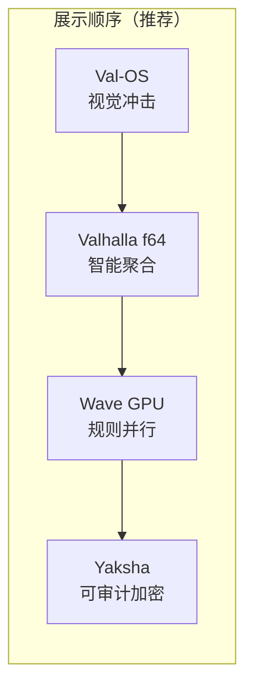

# Valhalla 展示手册 — MVP 与 DEMO

**出品 / By**: Rogue Intelligence LNC.  
**用途**: 天使/YC 会议、客户 POC、实验室展陈、内部门禁  
**更新 / Date**: 2026-06-05  
**原则**: **能跑、能复测、能截图** — 不依赖幻灯片代替可执行产物

---

## 0. 总览 / Overview

| 产品线 | MVP（最小可展示） | 旗舰 DEMO | 典型耗时 | 深度文档 |
|--------|-------------------|-----------|----------|----------|
| **夜叉 Yaksha** | `yaksha_test` smoke | `external_bench/run_all.sh` 全门禁 | 2 s / ~15 min | [产品介绍 §6](./VALHALLA_YAKSHA_WAVE_HUB_INTRODUCTION.md) |
| **Wave GPU** | `wave-bin/gpu/run.sh` 三条规则 | + `wave/gpu/opencl` 主树 demo | ~1 s / ~30 s | [Wave GPU 介绍](./WAVE_GPU_EMBEDDED_INTRODUCTION.md) |
| **Valhalla f64** | `valhalla_text_aggregation_smoke` | `hub_interact` 对话 + 语料短跑 | ~2 s / 5–10 min | [Hub/Tile/StemCell](./HUB_TILE_STEMCELL_INTRODUCTION.md) |
| **Valhalla 可视化** | `valhalla_dashboard` (:8765) | `valhalla_web_train` 全语料训练监控 | ~3 s / 长跑 | [产品定义 PD](./VALHALLA_PRODUCT_DEFINITION.md) |
| **Val-OS** | `val-os-minimal` 构建 + QEMU | v5 登录/桌面镜像 | 30 s / 2 min | [Val-OS 介绍](./VAL_OS_MINIMAL_INTRODUCTION.md) |



**一键非交互门禁**（会依次跑四条 MVP，约 1–3 分钟）：

```bash
cd /home/jouly/AI/Valhalla
./docs/run_mvp_demos.sh
```

---

## 1. 夜叉（Yaksha）— MVP & DEMO

### 1.1 MVP 定义

| 中文 | English |
|------|---------|
| 证明 **AEAD 往返正确**、core/parametric/neural 路径可用；**2 秒内** 给出 `all smoke checks OK`。 | Prove **AEAD round-trip**, core/parametric/neural paths; **`all smoke checks OK`** in ~2 s. |

**边界**：MVP **不** 含 dieharder / OpenSSL；完整可信度见 **Industry Gate**。

### 1.2 MVP 演示（30 秒）

```bash
cd valhalla-crypto/yaksha-cipher
cargo run --release --bin yaksha_test
```

**预期输出**（2026-06-05 实测）：

```
yaksha_test: smoke (roundtrip + AEAD). Full gate: external_bench/run_all.sh
yaksha_test: all smoke checks OK.
```

**口播要点**：
- 「这是可私有化部署的对称加密组件，smoke 证明功能正确。」
- 「完整门禁用 **第三方工具**：OpenSSL 吞吐对照 + dieharder STS，结果目录可审计。」

**勿说**：FIPS 认证、国密合规、吞吐超越 OpenSSL。

### 1.3 旗舰 DEMO（10–20 分钟，投资人/政企）

```bash
cd /home/jouly/AI/Valhalla
./external_bench/run_all.sh          # CPU 门禁
# 可选 GPU 轨（独立目录，不覆盖 CPU）：
./external_bench/run_all_gpu.sh
```

**展示文件**（已存档，可直接打开）：

| 产物 | 路径 |
|------|------|
| 摘要 | `external_bench/results/cpu_20260604_164641/report_summary.md` |
| JSON | `external_bench/results/cpu_20260604_164641/report.json` |
| STS 通过 | `dieharder_sts_monobit_d100.stdout` 等 |

**关键数字**（同机 CPU，2026-06-04）：

| 指标 | 结果 |
|------|------|
| smoke | **通过** |
| AEAD 16 MB seal | **83 MB/s** |
| dieharder STS d100–102 | **全部 PASSED** |
| OpenSSL AES-128-GCM（对照） | **≈ 9.3 GB/s** |

**口播**：「门禁重点是 **正确性 + 统计特征**，不是和 OpenSSL 比速度。」

---

## 2. Wave GPU 版 — MVP & DEMO

### 2.1 MVP 定义

| 中文 | English |
|------|---------|
| 证明 **八规则语义 → OpenCL kernel** 已映射并可执行；三条任务数值校验 **全部 OK**。 | Prove **eight-rule semantics → OpenCL kernels**; three tasks **all OK** with numeric verification. |

**路径**：`wave-bin/gpu/`（规则层宿主 `wave_gpu_host`，**非** `wavec.asm` 内嵌 codegen）。

### 2.2 MVP 演示（1 分钟）

```bash
cd wave-bin/gpu
./run.sh
```

**预期输出**（2026-06-05 实测）：

```
wave-bin/gpu: OpenCL backend ready (3 tasks from examples/rule_bench.wave)
[rule→OpenCL] rules=orbital+entropy  op=add  N=256  local=256  global=256  i=0.80 e=0.20 r=0.90
  kernel=vector_add  c[0]=0 c[1]=3 c[255]=765
[rule→OpenCL] rules=gravitational  op=sum  N=256  local=256  global=256  i=0.80 e=0.20 r=0.90
  kernel=reduce_sum  sum=32640 (expected 32640)
[rule→OpenCL] rules=entropy+gravitational  op=dot  N=256  local=256  global=256  i=0.80 e=0.20 r=0.90
  kernel=dot_product  dot=5625216 (expected 5625216)
wave-bin/gpu: all rule→OpenCL tasks OK
```

**口播要点**：
- 「Wave 用 **规则组合** 描述意图；GPU 侧自动选 local/global work-size（Unified Field `i,e,r`）。」
- 「Fate 驱动管线优先于『装个 OpenCL 库』。」

**勿说**：已全面超越 CUDA 手写 kernel；`wavec.bin` 已内嵌 GPU codegen（当前 **未做**）。

### 2.3 旗舰 DEMO（+ 嵌入式叙事，5 分钟）

```bash
# A. GPU 规则层（上）
cd wave-bin/gpu && ./run.sh

# B. 8 KB 裸机编译器体积
cd ../ && ./build.sh && ls -la wavec.bin

# C. 可选：主树 OpenCL demo
cd ../../wave/gpu/opencl && make run

# D. 可选：跨语言体积对比
cd ../../wave/bench && ./run_cross_language.sh
```

**对比表**（展陈用）：

| 指标 | Wave wave-bin | C gcc -O2 |
|------|---------------|-----------|
| 编译器体积 | **8192 B** | — |
| 同 workload ELF | **357 B** | **15 976 B** |

---

## 3. Valhalla f64 版（Hub · Tile · StemCell）— MVP & DEMO

### 3.1 MVP 定义

| 中文 | English |
|------|---------|
| 一条命令证明 **训练文本 → Hub 路由 / Tile 凝结 / StemCell 细胞** 三路闭环；输出 `OVERALL: PASS`。 | One command proves **text → Hub routing / Tile closure / StemCell cells**; prints `OVERALL: PASS`. |

**包名**：`hub-f64`（Valhalla 智能运行时 f64 栈）。

### 3.2 MVP 演示（2 分钟）

```bash
cd /home/jouly/AI/Valhalla
RUSTFLAGS='-L /opt/cuda/lib64' cargo run --release -p hub-f64 --bin valhalla_text_aggregation_smoke
```

**预期输出**（2026-06-05 实测）：

```
=== Hub / Tile / StemCell text aggregation smoke ===

Hub: signals=206 routed=[51, 52, 52, 51] prefs_len=4 OK=true
Tile: completed=3 ops=4 dim=4.00 OK=true
StemCell: cells=108 connections=0 dim=30.94 OK=true

OVERALL: PASS
```

**口播要点**：
- 「**无预设四系统分工** — 先轮询，Fate 再形成偏好。」
- 「Hub、Tile、StemCell **可独立卖**，smoke 证明文本自动聚合，非人工分桶。」

**勿说**：已超越 GPT-4；已公开 SOTA 榜单名次。

### 3.3 旗舰 DEMO A — Hub 交互对话（5–10 分钟）

```bash
RUSTFLAGS='-L /opt/cuda/lib64' cargo run --release -p hub-f64 --bin hub_interact
```

- 加载本地对话语料（`valhalla_*_dialogues.txt`）
-  stdin 输入问题，观察 **四系统路由** 与 Fate 决策
- 若有 checkpoint，可展示 **历史训练统计加载**（见 pitch 文档 §4.1）

### 3.4 旗舰 DEMO B — 语料短跑（展陈数字）

| 模块 | 命令 | 代表结果 |
|------|------|----------|
| Hub 聚合 | `valhalla_hub_aggregation` 等语料脚本 | **98,891** 信号 |
| Tile | `valhalla_tile_test` | 1308 条 → **20** Tile |
| StemCell | `valhalla_stemcell_test` | 1279 条 → **5,677** 细胞 |

详见 [`HUB_TILE_STEMCELL_INTRODUCTION.md`](./HUB_TILE_STEMCELL_INTRODUCTION.md) §3–§5。

---

## 4. Val-OS — MVP & DEMO

### 4.1 MVP 定义（技术证明）

| 中文 | English |
|------|---------|
| **Wave 源码 → 裸机镜像 → QEMU 启动**；镜像 **8704 B**，引导签名 **0x55AA**。 | **Wave source → bootable image → QEMU**; **8704 B**, boot **0x55AA**. |

### 4.2 MVP 演示（1 分钟终端 + 可选 GTK）

```bash
cd val-os-minimal
./build.sh
./run_qemu.sh    # 或: qemu-system-i386 -fda build/valos_minimal.img -display gtk
```

**构建成功标志**：

```
OK: build/valos_minimal.img (8704 bytes, boot 0x55AA)
```

**QEMU 内预期 VGA 文本**：

```
================================
 Val-OS Minimal Kernel v0
 Wave source -> machine code
================================
[boot] sector loaded
[kernel] entry ok
[kernel] idle ticks done
[status] VM feasible
```

### 4.3 旗舰 DEMO（视觉 WOW — Val-OS v5，2 分钟）

**镜像**：`val-os-v5/build/valos_interactive.img`（11,776 B）

```bash
qemu-system-i386 -fda val-os-v5/build/valos_interactive.img -m 32M -display gtk
# 登录界面按 Enter → 桌面 F/T/B/S
```

**截图**（文档内嵌，2026-06-05 重采）：

| 画面 | 文件 |
|------|------|
| 登录 | [`val-os-minimal/docs/screenshots/v5_login.png`](../val-os-minimal/docs/screenshots/v5_login.png) |
| 桌面 | [`val-os-minimal/docs/screenshots/v5_desktop.png`](../val-os-minimal/docs/screenshots/v5_desktop.png) |


**口播要点**：
- 「**同一门 Wave** 从应用写到操作系统；v5 是曾跑通的完整桌面，minimal 是 2026 干净重启的内核链。」
- 「语言即系统 — 不是 Linux 套壳。」

**勿说**：已量产硬件出货；旧 `val-os/valos_screen.png` 为无效占位图。

---

## 5. 组合展示脚本 / Combined Show Flows

### 5.1 闪电版（2 分钟 — Demo Day 后台预跑）

| 秒 | 动作 | 屏幕 |
|----|------|------|
| 0–15 | 播 v5 登录/桌面 **截图** 或预录 GIF | 视觉冲击 |
| 15–45 | 终端：`./docs/run_mvp_demos.sh` 末尾 PASS | 四条 MVP |
| 45–90 | 口述全栈图 + 模块化售卖 | 一页架构 |
| 90–120 | Ask + 试点意向 | — |

### 5.2 标准版（5 分钟 — 天使 1:1）

1. **Val-OS v5** QEMU 登录进桌面（30 s）  
2. **Valhalla f64** smoke → 指 `OVERALL: PASS`（30 s）  
3. **Wave GPU** `./run.sh` → 三条 kernel OK（30 s）  
4. **Yaksha** `yaksha_test` + 打开 `report_summary.md` 一页（60 s）  
5. 商业与试点（90 s）

### 5.3 实验室版（15 分钟 — 技术尽调）

1. 标准版 1–4  
2. `external_bench/run_all.sh` 完整跑（可事先跑好展示 `results/`）  
3. `hub_interact` 现场问答 3 轮  
4. `val-os-minimal/build.sh` 展示 Wave 直编链  
5. Q&A：CUDA 路径、`RUSTFLAGS`、StemCell 语料短跑数字

---

## 6. 环境与依赖 / Prerequisites

| 组件 | 依赖 |
|------|------|
| Yaksha MVP | `cargo`, Rust toolchain |
| Yaksha 全门禁 | `openssl`, `dieharder`, `python3` |
| Wave GPU | `gcc`, OpenCL ICD（本机 `libOpenCL`） |
| Valhalla f64 | `cargo`, CUDA 库路径 `RUSTFLAGS='-L /opt/cuda/lib64'` |
| Val-OS minimal | `archive/wave_c_compiler/wave_c`, `qemu-system-i386` |
| Val-OS v5 | `qemu-system-i386`, Python3（重生镜像时） |

---

## 7. MVP 通过标准 / Gate Criteria

| 产品 | 通过条件 |
|------|----------|
| Yaksha MVP | `yaksha_test` exit **0**，日志含 `all smoke checks OK` |
| Yaksha DEMO | `external_bench/results/cpu_*/` 全部 `*.exit` = 0，STS 无 FAILED/WEAK |
| Wave GPU MVP | `wave-bin/gpu/run.sh` 末行 `all rule→OpenCL tasks OK` |
| Valhalla f64 MVP | `OVERALL: PASS`，三路 `OK=true` |
| Val-OS MVP | `build.sh` 输出 `boot 0x55AA`；QEMU 可见内核文本或 v5 桌面 |

---

## 8. 对外表述清单 / Messaging

### 可以说

- 全栈 **可演示、可复测、可私有化**  
- Hub / Tile / StemCell **模块独立**  
- Wave **规则 → GPU** 与 **8 KB 编译器** 均有 runnable artifact  
- Val-OS **QEMU 已启动**（v5 桌面 + minimal 内核双叙事）  
- Yaksha **第三方 benchmark 门禁** 通过（附结果目录）

### 不要说

- 超越 GPT-4 / SOTA 大模型  
- FIPS / 国密已认证  
- 已有规模化 MRR（诚实：Pre-revenue，换试点）  
- wave-bin 内已完整 GPU codegen（当前在 `wave-bin/gpu` 并列分支）

---

## 9. 相关文档 / Related

| 文档 | 内容 |
|------|------|
| [`VALHALLA_ANGEL_YC_PITCH.md`](./VALHALLA_ANGEL_YC_PITCH.md) | 融资文稿与 2 分钟提纲 |
| [`VALHALLA_YAKSHA_WAVE_HUB_INTRODUCTION.md`](./VALHALLA_YAKSHA_WAVE_HUB_INTRODUCTION.md) | 全产品线介绍 |
| [`WAVE_GPU_EMBEDDED_INTRODUCTION.md`](./WAVE_GPU_EMBEDDED_INTRODUCTION.md) | Wave GPU + 嵌入式 |
| [`HUB_TILE_STEMCELL_INTRODUCTION.md`](./HUB_TILE_STEMCELL_INTRODUCTION.md) | f64 三路聚合 |
| [`VAL_OS_MINIMAL_INTRODUCTION.md`](./VAL_OS_MINIMAL_INTRODUCTION.md) | Val-OS 双版本 |

---

*Rogue Intelligence LNC. · Valhalla MVP/DEMO Playbook · 2026-06-05*
