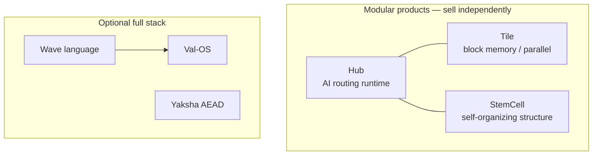

# Valhalla Product Definition (PD)

**Document type**: Product Definition — US benchmark alignment  
**Version**: 1.0  
**Date**: 2026-06-05  
**Publisher**: Rogue Intelligence LNC.  
**Companion docs**: [Technical Whitepaper](./whitepapers/VALHALLA_TECHNICAL_WHITEPAPER.md) · [**Valhalla vs Transformer**](./valhalla_vs_transformer/README.md) · [MVP/DEMO Playbook](./VALHALLA_MVP_DEMO_PLAYBOOK.md) · [YC Pitch](./VALHALLA_ANGEL_YC_PITCH.md)

---

## 1. Purpose / 文档目的

| 中文 | English |
|------|---------|
| 本文档是 Valhalla 的 **产品定义（PD）**，以美国主流 **企业 AI / MLOps / 安全** 资源为参照系，明确 **我们是什么、不是什么、对谁卖、如何验证**。 | This **Product Definition** positions Valhalla against common **US enterprise AI, MLOps, and security** reference points—what we are, what we are not, who we serve, and how we prove it. |

**PD ≠ 技术白皮书**：白皮书讲实现；PD 讲 **市场坐标、用户任务、模块化边界、可检验指标**。

---

## 2. Problem Statement / 问题陈述

### 2.1 US enterprise pain (2025–2026)

| Pain | US market signal | Valhalla response |
|------|------------------|-------------------|
| **API tax & vendor lock-in** | Closed LLM APIs dominate POCs; unit economics break at scale (OpenAI, Anthropic pricing pressure) | **Ownable stack**: Hub + optional Wave/Val-OS; no mandatory external inference API |
| **Black-box routing** | LangChain/LlamaIndex orchestrate calls but **do not** expose auditable internal routing state | **Observable runtime**: Fate preferences, quad routing, checkpoint `.hub` / `.valhalla` |
| **Forced deep-learning path** | Default stack = pretrain + fine-tune + RAG; high GPU cost | **Parallel path**: StemCell / Tile structure growth **without** preset backprop stack as sole route |
| **Data sovereignty** | FedRAMP, ITAR, China/ EU data residency drive **on-prem** RFPs | **Private deploy**: Rust binaries, local storage, optional Yaksha AEAD |
| **“Demo ≠ product”** | YC/investors require **runnable artifacts** (2026 bar) | **MVP gate**: smoke PASS, dashboard, external_bench, Val-OS boot |

### 2.2 We do NOT claim

- Replacing GPT-4 / Claude on general reasoning benchmarks  
- FIPS-certified encryption (see Yaksha whitepaper)  
- Out-of-box SOTA on MMLU / HumanEval  

---

## 3. Product Scope / 产品范围



| Module | US analog (loose) | Valhalla difference |
|--------|-------------------|---------------------|
| **Hub** | Orchestration layer (LangChain agents, Ray Serve routing) | **Native quad routing + Fate convergence**; not LLM-wrapper |
| **Tile** | Memory pool / allocator (jemalloc, CUDA pools) | **Tetris metaphor + Fate closure blocks**; text → tiles |
| **StemCell** | Graph / knowledge growth (Neo4j, custom nets) | **Biology metaphor; merge/split cycles**; no fixed layers |
| **Wave + Val-OS** | Language + OS (rare combo) | **Rule-driven language → bootable image** |
| **Yaksha** | Crypto module (OpenSSL libs) | **Industry Gate** (dieharder STS + OpenSSL baseline) |

---

## 4. Target Personas / 目标用户

| Persona | US title | Job-to-be-done | Entry product |
|---------|----------|----------------|---------------|
| **P1 Sovereign AI lead** | VP Eng / CISO (regulated industry) | Deploy AI **on-prem** with auditable data path | Hub + Yaksha |
| **P2 Vertical SaaS** | Head of ML / Platform Eng | Domain structure **accumulates** over months, not one-shot prompts | Hub or StemCell |
| **P3 Lab / university** | Research computing director | **Demonstrable OS + runtime** for curriculum & grants | Val-OS + Hub dashboard |
| **P4 Systems integrator** | Solutions architect | Modular SKUs, no forced full-stack deal | Hub **or** Tile **or** StemCell |

---

## 5. US Competitive Benchmark Matrix / 美国资源对标

Honest positioning vs **categories** common in US procurement and VC diligence—not feature parity claims.

| US reference | Category | They optimize for | Valhalla wedge | Honest gap |
|--------------|----------|-------------------|----------------|------------|
| **OpenAI / Anthropic API** | Closed LLM | General intelligence, scale | **Sovereignty, no API tax, observable routing** | General chat IQ |
| **AWS Bedrock / Azure OpenAI** | Cloud managed AI | Enterprise SLAs on **their** models | **Customer-owned binaries & checkpoints** | Hyperscaler ecosystem |
| **LangChain / LlamaIndex** | App orchestration | Fast LLM app wiring | **Native runtime + structure engines** | Huge OSS plugin ecosystem |
| **Ray / Modal / Anyscale** | Distributed compute | Scale-out training/inference | **Structure-growing path + OS narrative** | Elastic cloud scale |
| **Weights & Biases / MLflow** | Experiment tracking | Metric dashboards for **training jobs** | **Live Fate/quad viz + smoke dashboard** | Mature SaaS UX, team features |
| **Neo4j / vector DBs** | Graph / retrieval | Query & storage | **Emergent graph from text stream (StemCell)** | Mature query languages |
| **OpenSSL / BoringSSL** | Crypto primitives | Standards & speed | **Yaksha + third-party gate narrative** | Standards certification |

**Positioning sentence (EN)**  
*Valhalla is a modular, deployable AI runtime for teams that need observable routing and owned infrastructure—not another chat API wrapper.*

**定位句（中文）**  
*Valhalla 是可私有化部署、路由可观测的 AI 运行时模块集，面向不能接受 API 锁定与黑箱调度的政企与垂直行业——不是又一个 Chat 套壳。*

---

## 6. Core User Stories / 核心用户故事

| ID | Story | Acceptance (testable) |
|----|-------|------------------------|
| US-1 | As a platform lead, I run **text aggregation smoke** to prove text → structure works | `OVERALL: PASS` |
| US-2 | As a demo engineer, I open **dashboard** in browser for investors | `http://127.0.0.1:8765/` shows Hub/Tile/StemCell |
| US-3 | As security, I audit **Yaksha gate** logs | `external_bench/results/cpu_*` all `.exit` = 0 |
| US-4 | As OS lab, I boot **Val-OS** in QEMU | `val-os-minimal` or v5 desktop |
| US-5 | As ML lead, I load **Hub checkpoint** and inspect Fate drift | `web_training` / `.valhalla` (full corpus) |

---

## 7. MVP Definition / MVP 定义

| Layer | MVP artifact | Command / URL |
|-------|--------------|---------------|
| **Valhalla core** | Text aggregation smoke | `cargo run -p hub-f64 --bin valhalla_text_aggregation_smoke` |
| **Visualization** | Dashboard | `./docs/valhalla/run_dashboard.sh` → `:8765` |
| **Full stack demo** | 4-product MVP script | `./docs/run_mvp_demos.sh` |
| **Training viz (advanced)** | Web training monitor | `valhalla_web_train` (corpus + CUDA) |
| **Docs** | PD + whitepapers | This file + `docs/whitepapers/` |

---

## 8. Success Metrics / 成功指标

### 8.1 Engineering gates (pre-revenue)

| Metric | Target | Source |
|--------|--------|--------|
| Smoke pass rate | 100% on CI hardware | `SmokeReport.overall_pass` |
| Dashboard availability | Local serve < 5 s after build | `valhalla_dashboard` |
| Hub explore fairness | Quad route counts within ±15% on smoke corpus | Dashboard hub bars |
| Yaksha STS gate | d100–102 PASSED | `external_bench` |
| Val-OS boot | `0x55AA` | `val-os-minimal/build.sh` |

### 8.2 Business metrics (post-seed, 12 mo)

| Metric | US investor expectation | Our draft target |
|--------|-------------------------|----------------|
| Paid pilots / LOI | 2–3 design partners | 3 |
| Weekly active **deployments** | Usage > vanity ARR early | Contract-defined |
| Third-party re-test | Audit packet for procurement | 1 CPU Yaksha report + 1 Hub POC doc |

---

## 9. Packaging & GTM / 包装与交付

| SKU | Deliverable | US buyer language |
|-----|-------------|-------------------|
| **Hub Enterprise** | `hub-f64` binaries + dashboard + integration guide | "Private AI routing runtime" |
| **StemCell Module** | `stem-cell` crate + corpus playbook | "Structure-growing knowledge engine" |
| **Tile Module** | `valhalla-tile-quattro` | "Low-fragmentation block runtime" |
| **Full stack OEM** | Wave + Val-OS + Hub | "Bootable sovereign AI workstation image" |
| **Yaksha Security Pack** | AEAD + `external_bench` report bundle | "Reproducible crypto gate package" |

---

## 10. Visualization / 可视化

### 10.1 Dashboard (recommended for PD demos)

```bash
./docs/valhalla/run_dashboard.sh
# Open http://127.0.0.1:8765/
```

**Shows**: architecture flow, Hub quad routing bars, Fate preference %, Tile/StemCell stats, PASS/FAIL badge, re-run smoke.

### 10.2 Advanced (training corpus)

| Binary | Port | Requires |
|--------|------|----------|
| `valhalla_web_train` | 8080 (default) | Large corpus, CUDA |
| `valhalla_dialogue` | configurable | Dialogue files |

### 10.3 Static architecture

See [Valhalla Technical Whitepaper §3](./whitepapers/VALHALLA_TECHNICAL_WHITEPAPER.md) Mermaid diagrams.

---

## 11. Roadmap alignment / 路线图

| Phase | US milestone language | Valhalla deliverable |
|-------|----------------------|----------------------|
| **Now** | "Show me it runs" | Smoke + dashboard + MVP script |
| **+3 mo** | "One vertical POC" | Hub + StemCell on customer corpus |
| **+6 mo** | "Deployable installer" | Docker/systemd + CUDA optional |
| **+12 mo** | "Paid expansion" | 3 pilots → support SLA |

---

## 12. References / 参考

| Doc | Role |
|-----|------|
| [VALHALLA_TECHNICAL_WHITEPAPER.md](./whitepapers/VALHALLA_TECHNICAL_WHITEPAPER.md) | Engineering architecture |
| [valhalla_vs_transformer/](./valhalla_vs_transformer/README.md) | AI incubation vs Transformer (ZH/EN intro, BP, whitepaper) |
| [VALHALLA_MVP_DEMO_PLAYBOOK.md](./VALHALLA_MVP_DEMO_PLAYBOOK.md) | Demo scripts |
| [VALHALLA_ANGEL_YC_PITCH.md](./VALHALLA_ANGEL_YC_PITCH.md) | Investor narrative |
| [HUB_TILE_STEMCELL_INTRODUCTION.md](./HUB_TILE_STEMCELL_INTRODUCTION.md) | Test numbers |

---

*Rogue Intelligence LNC. · Valhalla Product Definition v1.0 · 2026-06-05*
