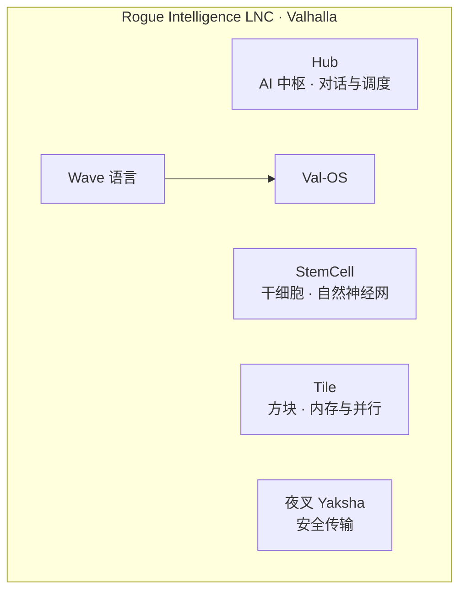
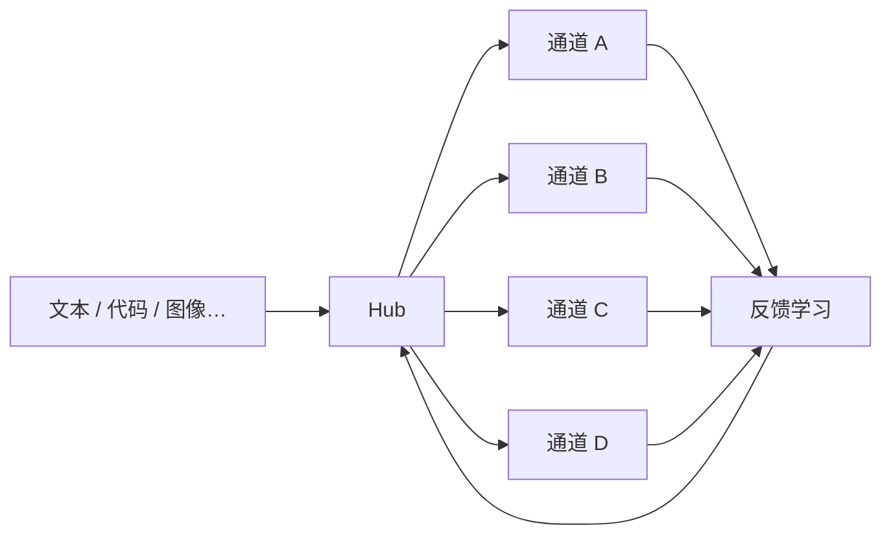
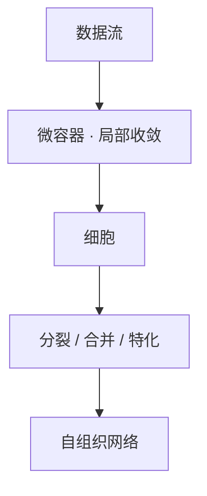
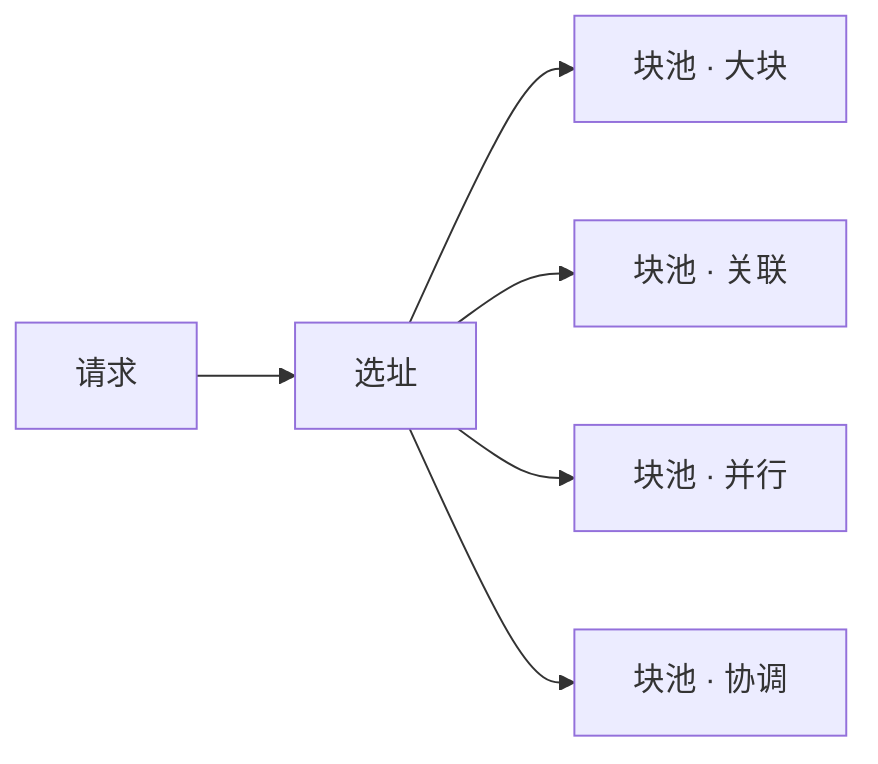
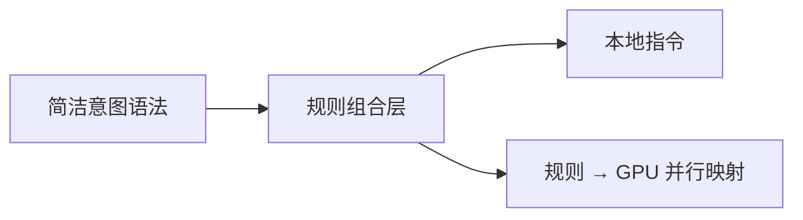
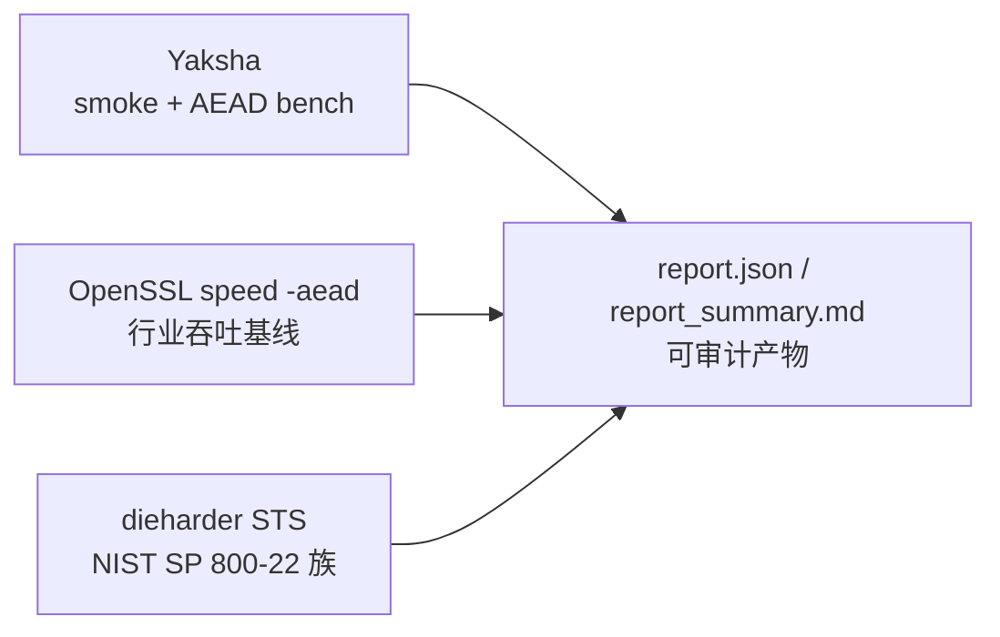
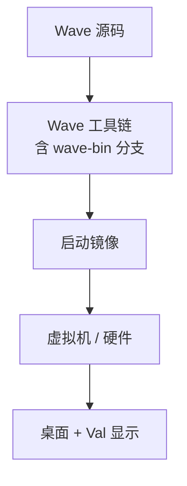
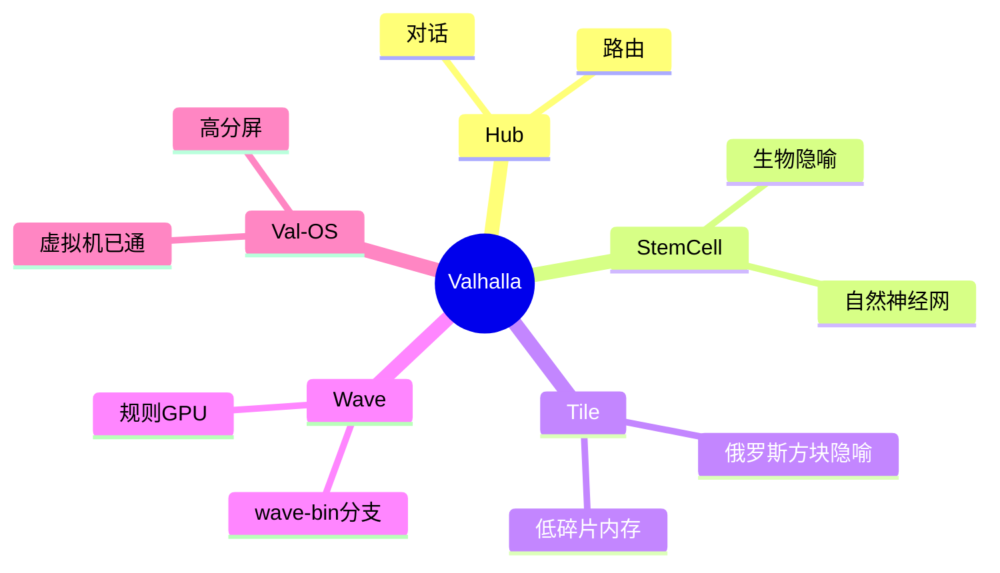

# Valhalla 产品介绍

**出品**：Rogue Intelligence LNC（肉鸽智能有限公司）

---

## 1. Valhalla 是什么

Valhalla 是 Rogue Intelligence LNC 旗下的的技术线——中枢对话（Hub）、生物隐喻的智能组织（干细胞）、俄罗斯方块隐喻的文本处理方式（Tile）来达到自然的训练文本处理，尝试非深度训练之外的可能性，以及 Wave 语言与 Val-OS 系统栈。



| 维度 | 说明 |
|------|------|
| **定位** | 专用智能系统孵化：可控、可观测、可沉淀 |
| **与主流深度学习** | 干细胞 / Tile 路线强调 **结构自组织**，**非** 堆叠强制反向传播的大模型范式 |
| **模块关系** | Hub、干细胞、Tile **并列**；可按项目只选其一或组合，无「必须三者同开」 |

---

## 2. Hub — AI 中枢（独立产品线）

Hub 是 Valhalla 的 **AI 项目主入口**：多模态输入 → 统一信号 → 调度引擎分流 → 学习反馈。面向 **对话、语料试验、路由策略验证**。



| 能力 | 说明 |
|------|------|
| 统一接入 | 对话与实验任务同一套协议 |
| 智能路由 | 按历史表现倾向更合适通道 |
| 状态延续 | 支持长期训练/对话状态加载 |

**适用**：垂直助手原型、多模态标注台、调度策略研究。  
**说明**：Hub **不依赖** 干细胞或 Tile 才能运行；后两者为 **可选增强**，非 Hub 子模块。

---

## 3. StemCell — 干细胞网络（独立产品线）

### 3.1 命名与意图

**StemCell** 取义 **生物学干细胞**：未分化单元在环境中 **分裂、合并、特化**，逐步形成组织。  
设计目标：**让连接与结构自然涌现**，形成类神经网络拓扑，**脱离「强制深度学习」机制**（不预设固定层数、不依赖标准反向传播训练栈作为唯一路径）。



| 能力 | 说明 |
|------|------|
| 局部收敛 | 小范围稳定后再进入全局 |
| 网络演化 | 连接随数据与反馈变化 |
| 范式 | **自然神经网形成**，而非手工堆深度 |

**适用**：渐进式知识整理、长周期行为序列、需要「越用越成结构」的数据环境。

---

## 4. Tile — 方块系统（独立产品线）

### 4.1 命名与意图

**Tile** 取义 **俄罗斯方块（Tetris）**：资源被切成可 **嵌入、消行、重组** 的方块单元，在网格中 **紧凑排列、减少空洞**。  
在工程中对应：**低碎片内存组织 + 并行块调度**；四类「池」负责不同形状与用途的数据块，由调度器选址放置。



| 能力 | 说明 |
|------|------|
| 方块化分配 | 像拼方块一样占用与释放，降低碎片 |
| 四池分工 | 高密度 / 关联 / 并行 / 协调分流 |
| 与 Val-OS | 操作系统侧内存管理 **同族概念**，与 Hub **无强耦合** |

**适用**：长时间运行的工作站、私有化算力节点、嵌入式多任务场景。

---

## 5. Wave 语言与 wave-bin 分支

Wave 为自研 **规则驱动语言**：**语法简单**；通过 **规则组合** 把接近意图的写法 **升维** 为机器行为（低级规则 → 高级语义）。  
**wave-bin** 是 Wave 工具链的 **一分支**，面向裸机 / 系统引导编译，**不是** 独立产品。



Val-OS 与 Wave **紧密结合**（系统源码以 Wave 为主）；Val 另具备 **自研高分屏 / 多屏显示方案**，与 Wave 栈垂直整合。

### 5.1 Wave / wave-bin 基准（本机实测，2026-06）

**Workload**：1000 万次循环 `sum += i*i`（与 C / Python 同源微基准，`wave/bench/run_cross_language.sh`）。

| 实现 | 耗时（5 次平均） | 二进制大小 |
|------|------------------|------------|
| **Wave C 版（wave-bin / wavebin）** | ≈ 0.000 s* | **357 B** |
| **C（gcc -O2）** | **0.018 s** | 15 976 B |
| **Python 3** | 3.666 s | — |

\* 当前 wave-bin 对该 workload 生成极精简 ELF；完整循环语义以工具链演进为准。  

**wave-bin 编译器本体**：`wavec.bin` **8192 B**（`wave-bin/build.sh` 构建）。

**Wave 应用链（wavec）**：示例 `hello.wave` 可编译运行，输出 `Hello, Wave!`（ELF 级演示可用）。

---

## 6. 夜叉（Yaksha）— 安全传输

独立 **加密与认证（AEAD）** 组件，可选接入存储或信道保护。对外披露采用 **第三方工具 + 可复现脚本** 的业界门禁，**不** 自报「已通过认证」；算法细节见内部技术文档，本介绍仅列 **可审计的 benchmark 与合规边界**。

### 6.1 合规与表述边界（对外必读）

| 项目 | 说明 |
|------|------|
| **产品性质** | 研究型对称加密库（Rust，`valhalla-crypto/yaksha-cipher`），提供 AEAD 封装 |
| **非 FIPS 模块** | **未** 参与 NIST CAVP / FIPS 140-3 验证；**不得** 对外宣称「FIPS 认证」「国密合规」等 |
| **统计测试含义** | 通过 NIST SP 800-22 **族** 统计项（经 dieharder 实现）仅说明 **密文流统计特征**，**不能** 替代形式化密码分析或渗透审计 |
| **性能对比含义** | OpenSSL `speed -aead` 为 **同机、同脚本** 下的行业 **事实标准基线**（de facto），非竞赛排名 |
| **结果适用范围** | 下列数值绑定 **具体硬件、编译器、日期**；第三方复现应以本仓库脚本与原始日志为准 |
| **出口与用途** | 客户须自行评估司法辖区对加密产品的注册、出口管制与行业合规要求；本文档不构成法律意见 |

### 6.2 门禁方法论（Industry Gate）

夜叉的 **唯一统计门禁** 为仓库根目录 **`external_bench/`** 外置套件（详见 `external_bench/README.md`、`valhalla-crypto/yaksha-cipher/docs/STRICT_TESTING.md`）：



| 步骤 | 工具 / 标准 | 门禁条件 |
|------|-------------|----------|
| 1 | `yaksha_test` | 往返与 AEAD smoke，**exit 0** |
| 2 | `yaksha_aead_bench` | 多块长 AEAD 吞吐记录，**exit 0** |
| 3 | `yaksha_aead_timing_keys` | 时序/密钥敏感性探测，**exit 0** |
| 4 | `generate_test_data` | 生成 **64 MB** 密文流（默认 `DIEHARDER_MODE=neural`），大小 ≥ 名义值 **95%** |
| 5 | **OpenSSL** `speed -aead -mr` | AES-128/256-GCM、ChaCha20-Poly1305，**必须成功**（脚本内无 `|| true`） |
| 6 | **dieharder** STS **严格门** | `-d 100,101,102`（monobit / runs / serial），`-t 500`、`-p 500`；任一 **FAILED / WEAK / 非零退出** → 整体失败 |

**默认参数**（`external_bench/bench_common.sh`）：`OPENSSL_SECONDS=10`，`DIEHARDER_MB=64`，`DIEHARDER_TSAMPLES=500`，`DIEHARDER_PSAMPLES=500`。

**独立 CPU / GPU 两轨**：`run_all.sh` → `results/cpu_<时间戳>/`；`run_all_gpu.sh` → `results/gpu_<时间戳>/`（互不覆盖）。

### 6.3 业界标准对照（夜叉如何对接）

| 标准 / 基准 | 业界角色 | 夜叉对接方式 | 对外可陈述 |
|-------------|----------|--------------|------------|
| **NIST SP 800-22** | 随机性统计测试（STS） | dieharder 实现 STS 子集 **d=100–102** | 「密文流在 STS 门禁子集上 **无 FAILED/WEAK**」 |
| **dieharder 3.x** | Marsaglia / Brown 随机性测试套件 | 门禁流 `dieharder_stream.bin`，经典 Diehard **仅记录**（`dieharder_info_*.stdout`，**不** 作失败条件） | 附原始 `.stdout` 可审计 |
| **OpenSSL speed** | TLS 生态事实 AEAD 性能基线 | 同脚本 `-aead -evp` 机器可读输出 `.mr` | 「同环境 OpenSSL 对照吞吐」 |
| **NIST CAVP / FIPS 140** | 美国联邦算法验证 | **不适用**（非 FIPS 算法） | **不得** 宣称通过 |
| **NIST LWC（SP 800-232）** | 轻量密码标准化（已结束） | 未参赛；可参考评估维度 | 仅研究对比，非标准宣称 |
| **eBACS / SUPERCOP** | 学术性能基准 | 可作未来扩展 | 当前门禁未纳入 |
| **Wycheproof 思路** | 已知向量攻击测试 | 库内 KAT + `yaksha_test` smoke | 正确性门，非统计门 |

### 6.4 功能正确性（smoke，2026-06-04）

**命令**：`./external_bench/run_all.sh`  
**产物**：`external_bench/results/cpu_20260604_164641/yaksha_test.exit` = **0**

| 检查项 | 结果 |
|--------|------|
| core / parametric / neural 往返 | **OK** |
| YakshaAead seal → open 往返 | **OK** |
| 日志摘要 | `yaksha_test: all smoke checks OK.` |

### 6.5 AEAD 吞吐（YakshaAead，含分配开销）

**同源 CSV**：`yaksha_aead_bench.csv` / `report.json`（同上结果目录）

| 数据块 | seal (MB/s) | seal (ns/op) | open (MB/s) | open (ns/op) |
|--------|------------:|-------------:|------------:|-------------:|
| 4 KB | 22 | 1.75×10⁵ | 7 | 5.90×10⁵ |
| 64 KB | 36 | 1.74×10⁶ | 41 | 1.52×10⁶ |
| 256 KB | **69** | 3.63×10⁶ | **72** | 3.47×10⁶ |
| 1 MB | **79** | 1.26×10⁷ | **77** | 1.29×10⁷ |
| 4 MB | **83** | 4.84×10⁷ | **80** | 4.99×10⁷ |
| 16 MB | **83** | 1.93×10⁸ | **77** | 2.08×10⁸ |

**读数说明**：吞吐含 Rust 侧缓冲分配；块越大越接近稳态。**吞吐非夜叉主卖点**；门禁重点是 **正确性 + 统计门**。

### 6.6 随机性统计门禁（NIST SP 800-22 族 / dieharder STS）

**输入流**：64 MB 密文（`generate_test_data neural 64 random`）  
**工具**：dieharder **3.31.1**，`file_input_raw`，`-g 201`

| 测试 ID | NIST STS 对应 | tsamples | psamples | 评估 | 代表 p-value |
|---------|---------------|----------|----------|------|-------------|
| **d=100** | Frequency (Monobit) | 500 | 500 | **PASSED** | 0.0537 |
| **d=101** | Runs | 500 | 500 | **PASSED** | 0.0097 |
| **d=102** | Serial（含 lag 1–16 子项） | 500 | 500 | **全部 PASSED** | 例：0.0537, 0.0316, 0.8328… |

**严格门结论**：STS 子集 **无 FAILED、无 WEAK**；每份门禁日志均含 `PASSED` 行。原始文件：

- `dieharder_sts_monobit_d100.stdout`
- `dieharder_sts_runs_d101.stdout`
- `dieharder_sts_serial_d102.stdout`

**信息性附录**（**不** 作失败条件）：d=4,9,10,15,16,205 等经典 Diehard 测试，见 `dieharder_info_*.stdout`。

### 6.7 OpenSSL AEAD 对照（同脚本、同机，2026-06-04）

**命令**：`openssl speed -aead -evp <cipher> -seconds 10 -mr`  
**机器可读末行**（`.mr` 文件 `+F:` 记录，单位 bytes/s）：

| 算法 | 末档吞吐（约） | 备注 |
|------|----------------|------|
| AES-128-GCM | **≈ 9.35 GB/s** | OpenSSL 硬件/汇编优化路径 |
| AES-256-GCM | **≈ 8.05 GB/s** | 同上 |
| ChaCha20-Poly1305 | **≈ 3.40 GB/s** | 同上 |

**对比解读（16 MB 档）**：夜叉 YakshaAead **≈ 83 MB/s** vs OpenSSL AES-128-GCM **≈ 9.3 GB/s** — 数量级差异来自 **标准算法 + 厂商优化**；夜叉门禁 **不** 以追平 OpenSSL 吞吐为目标，而以 **可复现正确性 + STS 统计门** 建立可信度。

### 6.8 第三方复现（提高可信度）

```bash
# 依赖：openssl, dieharder, cargo, python3
cd /path/to/Valhalla
./external_bench/run_all.sh          # CPU 门禁 → results/cpu_<时间戳>/
./external_bench/run_all_gpu.sh      # GPU 门禁（可选，独立目录）

# 审阅产物
cat external_bench/results/cpu_*/report_summary.md
cat external_bench/results/cpu_*/report.json
```

**审计清单**：所有 `*.exit` 为 `0`；`dieharder_sts_*.stdout` 无 FAILED/WEAK；`report.json` 与本文表格一致。变更算法或实现后应 **重跑全门禁** 并更新结果目录时间戳。

**工程白皮书**（模块架构、AEAD 流程、Industry Gate 契约）：[`docs/whitepapers/YAKSHA_TECHNICAL_WHITEPAPER.md`](./whitepapers/YAKSHA_TECHNICAL_WHITEPAPER.md)

---

## 7. Val-OS 与 Val 显示

Val-OS：**Wave 原生操作系统**，虚拟机已 **跑通**（登录、桌面、终端、文件、设置等）。  
构建链含 **wave-bin 分支**（引导镜像）与常规 ELF 分支（应用开发）。

**Val 显示**：自研 **高分辨率 / 多屏** 因其规则的特性 矢量图转换容易，高分屏适配度不同。



---

## 8. 典型应用组合（模块可拆）

| 需求 | 建议选用 | 说明 |
|------|----------|------|
| 对话 / 调度试验 | **Hub** | 单独即可演示 |
| 结构自生长、非强制深度学习 | **StemCell** | 与 Hub 无硬性依赖 |
| 内存 / 并行块管理 | **Tile** | 可与 Val-OS 同叙事，不必挂 Hub |
| 系统 + 语言一体 | **Wave + Val-OS** | wave-bin 服务引导 |
| 数据保护 | **夜叉** | 可选 |



---

## 9. 成熟度（对外）

| 组件 | 状态 |
|------|------|
| Hub 对话 | 可演示 |
| 干细胞 / Tile | 工程可用，独立集成 |
| Wave / wave-bin | 可编译；见 §5.1 跑分 |
| 夜叉 | 外置 Industry Gate 通过（smoke + OpenSSL 对照 + STS）；见 §6 |
| Val-OS 虚拟机 | 最简洁版虚拟机已跑通 |
|                 |                               |

---

## 10. 品牌

**Rogue Intelligence LNC（游侠智能有限公司）**  
**Valhalla** · **Wave** · **Val-OS** · **Yaksha（夜叉）**

---

## 11. 展示与演示

可执行 **MVP / DEMO** 脚本与 2/5/15 分钟展陈流程：[`VALHALLA_MVP_DEMO_PLAYBOOK.md`](./VALHALLA_MVP_DEMO_PLAYBOOK.md)  
一键门禁：`./docs/run_mvp_demos.sh`

## 12. 技术白皮书

工程向架构文档：

| 文档 | 范围 |
|------|------|
| [Valhalla 技术白皮书](./whitepapers/VALHALLA_TECHNICAL_WHITEPAPER.md) | Hub / Tile / StemCell / Fate f64 栈 |
| [Wave 技术白皮书](./whitepapers/WAVE_TECHNICAL_WHITEPAPER.md) | 语言、编译链、GPU 规则层、Val-OS 集成 |
| [夜叉 Yaksha 技术白皮书](./whitepapers/YAKSHA_TECHNICAL_WHITEPAPER.md) | AEAD、Industry Gate、合规边界 |

## 13. 产品定义与可视化

| 资源 | 说明 |
|------|------|
| [Valhalla 产品定义 PD](./VALHALLA_PRODUCT_DEFINITION.md) | 对标美国 AI/MLOps/安全资源 · 模块化 GTM |
| **可视化仪表盘** | `./docs/valhalla/run_dashboard.sh` → http://127.0.0.1:8765/ |
| Canvas | IDE 内打开 `valhalla-us-benchmark.canvas.tsx`（对标矩阵 + smoke 路由图） |

---

*文档版本：2026-06 · Rogue Intelligence LNC*
