# Hybrid Valhalla 2.0 — 系统架构详细参考  
# Hybrid Valhalla 2.0 — Detailed Architecture Reference

**Version / 版本**: hybrid-2.0 · fair-1.2 · hub-f64 **1.1.0**  
**Date / 日期**: 2026-06-22  
**Purpose / 用途**: 梳理全栈架构、数据流、模块边界与产物 — 供生成图表、白皮书、DD 文档  
**Publisher**: Rogue Intelligence LNC.

---

## 0. 阅读指南 / Reading guide

| 章节 | 内容 |
|------|------|
| §1 | 一句话 + 分层总览 |
| §2 | 全栈分层架构（L0–L6） |
| §3 | 核心模块详解（Hub / Tile / StemCell / Fate / Quad） |
| §4 | 信号与 Ingress 流水线 |
| §5 | Tier B 原生记忆路径（persistent incubation） |
| §6 | MCQ Fate 多循环管线 |
| §7 | 解码器（open / mcq / numeric） |
| §8 | Tier A 补丁 LM 路径 |
| §9 | Hybrid 2.0 统一路由器 |
| §10 | Fair Benchmark 评测 harness |
| §11 | 会话协议对比（isolated vs persistent） |
| §12 | 产物、二进制与文件映射 |
| §13 | 环境变量与配置面 |
| §14 | 公开仓库与 API 层 |
| §15 | 当前性能锚点（分题型） |
| §16 | 已知瓶颈与路线图 |
| §17 | 图表索引（可导出 Mermaid） |

---

## 1. 一句话架构 / One-line architecture

**中文**：语料经 **Grinder/DL Front** 变成数值信号 → **Hub/Tile/StemCell** 在 **Fate** 控制下孵化结构 → 问题经 **Hybrid 路由器** 分到 **原生记忆解码** 或 **Qwen+结构补丁生成** → 输出答案 + **路由轨迹**。

**English**: Corpus → **Grinder/DL Front** vectors → **Hub/Tile/StemCell** structure incubation under **Fate** → questions routed by **Hybrid 2.0** to **native memory decode** or **Qwen + structure patch generate** → answer + **routing trace**.

---

## 2. 全栈分层（L0–L6）/ Full stack layers

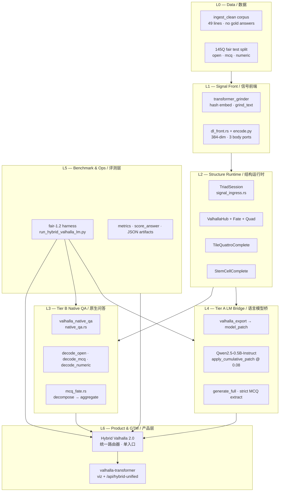

### 2.1 层级职责表

| Layer | 组件 | 职责 | 是否 LLM forward |
|-------|------|------|------------------|
| L0 | corpus, prompts | 输入数据；语料无答案泄漏 | — |
| L1 | grinder, dl_front | 文本/模态 → f64 向量 + 三 body 端口 | 可选 sidecar encoder |
| L2 | TriadSession, Hub/Tile/Stem | 结构孵化、Fate 收敛、patch 导出 | ❌ |
| L3 | native_qa, mcq_fate | 规则/检索/打分解码 | ❌ |
| L4 | patch_track, HF Qwen | 权重补丁 + token 生成 | ✅ |
| L5 | fair_benchmark, hybrid runner | 分轨道评测、合并、JSON | 混合 |
| L6 | Hybrid product, public API | 对外单一产品 | 按路由 |

---

## 3. 核心模块详解 / Core modules

### 3.1 Hub — 路由中枢

**源码**: `manifestsys/hub-f64/src/lib.rs` · `ValhallaHub`

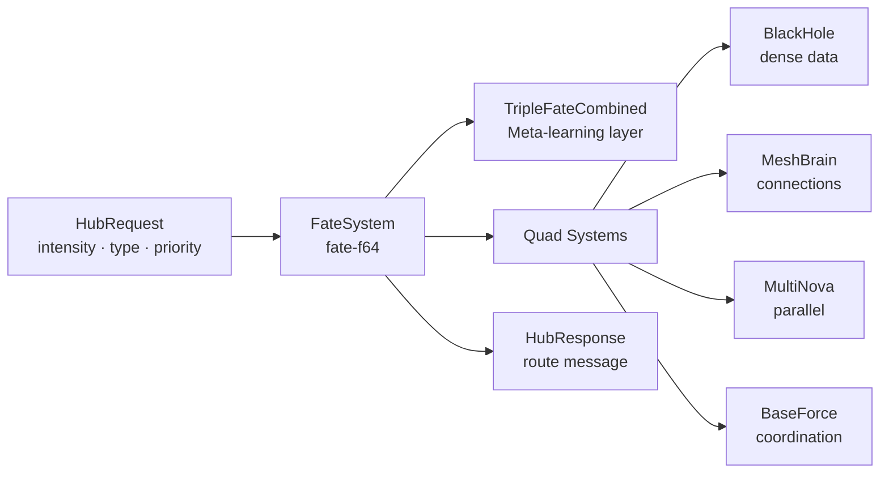

| 属性 | 说明 |
|------|------|
| **角色** | 每个 ingress 信号经 `hub.process()` → quad 路由计数 `hub_routed[4]` |
| **输出** | `hub_prefs` / `fate_affinities` — 写入 patch 与 decode 权重 |
| **Body 模式** | `BodyTarget::Hub` 仅喂 Hub；`Triad` 喂 Hub+Tile+Stem |
| **收敛** | `has_fate_converged()` · `get_fate_convergence_pattern()` → fixed_point / converging |

### 3.2 Tile — 块记忆

**源码**: `manifestsys/tile-quattro` · `TileQuattroComplete` in TriadSession

| 属性 | 说明 |
|------|------|
| **隐喻** | 俄罗斯方块式块嵌入与重组 |
| **Ingress** | `receive_batch(ports.tile)` 或标量 `receive_data(v)` |
| **循环** | `process_tiles_cycle()` until `has_fate_converged()` |
| **产物** | `completed_tiles` → `tile_signatures`, `tile_activations`, `tile_count` |
| **Hybrid 角色** | **MCQ 最佳 body**（22–24/46）；Tile+Fate persistent 轨道 |

### 3.3 StemCell — 细胞结构

**源码**: `manifestsys/stem-cell` · `StemCellComplete`

| 属性 | 说明 |
|------|------|
| **隐喻** | 细胞分裂/特化、自组织簇 |
| **Ingress** | `receive_batch(ports.stem)` · 周期性 `receive_data(0.0)` 触发 |
| **循环** | `process_cells_cycle()` · `evolve(0.5/0.35)` |
| **产物** | `stem_organ_clusters`, `stem_cluster_signatures`, `stem_cell_count` |
| **Hybrid 角色** | Triad 记忆轨道；MCQ 上弱于 Tile alone |

### 3.4 Fate — 动态停止与规则

**源码**: `systems/metasystems/fate-f64` · 各 body 内 `triple_fate`

| 机制 | 用途 |
|------|------|
| `has_fate_converged()` | Hub/Tile/Stem 各自收敛检测 |
| `fate_closure_score` | MCQ 聚合阶段连续闭包信号 [0,1] |
| `fate_should_stop()` | 动态轮次：marginal stable / fixed_point / aggregate_ready |
| MCQ 规则 | `task_tag:mcq`, decompose, aggregate, dynamic_rounds |

### 3.5 BodyTarget — 可切换 body

```rust
// signal_ingress.rs
pub enum BodyTarget {
    Triad,      // Hub + Tile + StemCell（默认）
    Hub,        // 仅 Hub
    Tile,       // 仅 Tile
    StemCell,   // 仅 StemCell
}
```

| Body | Hybrid 中的轨道 | 145Q test 准确率（memory only） |
|------|-----------------|--------------------------------|
| triad | `triad_persistent` | 39.31% |
| tile (+ MCQ Fate) | `tile_fate_persistent` | 41.38%（MCQ 52.17%） |
| hub / stemcell | 实验 arm | 非 Hybrid 默认 |

---

## 4. 信号与 Ingress 流水线 / Signal ingress pipeline

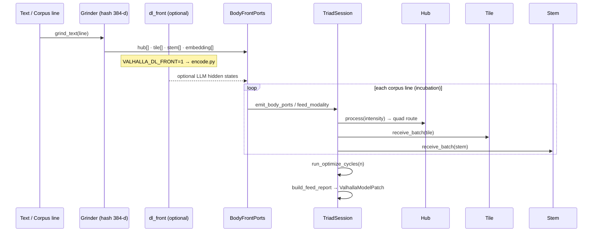

### 4.1 Grinder（默认路径）

| 项 | 值 |
|----|-----|
| 工具 | `tools/transformer_grinder/grind.py` |
| 后端 | `hash`（确定性，离线可复现） |
| 维度 | `DL_EMBED_DIM = 384` |
| 输出 | `question_ports` / `corpus_ports` → JSON 传入 native_qa |

### 4.2 DL Front（可选）

| 项 | 值 |
|----|-----|
| Rust | `manifestsys/hub-f64/src/dl_front.rs` |
| Python sidecar | `tools/valhalla_dl_front/encode.py` |
| 开关 | `VALHALLA_DL_FRONT=1` |
| 端口种子 | HUB_FNT / TILE_FNT / STEM_FNT |

### 4.3 ValhallaModelPatch 结构

导出字段（Tier A 与 Tier B decode 共用）：

| 字段 | 含义 |
|------|------|
| `body_source` | hub / tile / stemcell / triad |
| `fate_affinities` | Hub Fate 偏好向量 |
| `hub_routed[4]` | Quad 路由计数 |
| `quad_layer_scales[4]` | → Transformer LayerNorm 缩放 |
| `patch_vector` | → prompt embedding 扰动 |
| `tile_signatures[]` | Tile 块签名 |
| `stem_cluster_signatures[]` | Stem 器官簇签名 |
| `tile_count`, `stem_cell_count` | 结构规模指标 |

---

## 5. Tier B：原生记忆路径 / Native memory path

### 5.1 Persistent batch 协议（Hybrid 默认）

```mermaid
flowchart TB
  subgraph Phase1["Phase 1 — Incubation（一次）"]
    C1["corpus[0..49]<br/>corpus_ports[]"]
    I1["TriadSession.with_body(tile|triad)"]
    I2["emit each corpus line"]
    I3["run_optimize_cycles(incubation_cycles)"]
    SNAP["TriadIncubationSnapshot<br/>tiles · stem · hub_prefs"]
    C1 --> I1 --> I2 --> I3 --> SNAP
  end

  subgraph Phase2["Phase 2 — QA batch（多题）"]
    Q1["for each question"]
    Q2["fork: from_incubation_snapshot()"]
    Q3["push question MemoryEntry + question_ports"]
    Q4["optional: mcq_fate pipeline"]
    Q5["build_feed_report(qa_cycles)"]
    Q6["decode_from_report(score_type)"]
    SNAP --> Q2
    Q1 --> Q2 --> Q3 --> Q4 --> Q5 --> Q6
  end
```

**关键**：语料 **只 ingress 一次**；每题 fork 快照，**不**重读语料 → MCQ 从 ~28% 升至 ~46–52%。

**实现入口**:
- Python: `tools/fair_benchmark/session.py` → `native_qa_batch_persistent()`
- Rust: `native_qa.rs` → `run_native_qa_batch()`

### 5.2 Isolated 协议（旧默认 / 对照）

每题：`corpus + question` 完整 re-ingest → 结构弱 → MCQ ~28%。Fair benchmark 中标记为 `session: isolated`。

### 5.3 Memory 条目

```rust
MemoryEntry {
    text: String,
    signals: Vec<f64>,      // embedding
    source: "corpus" | "question",
    corpus_idx: Option<usize>,
}
```

---

## 6. MCQ Fate 多循环管线 / MCQ Fate pipeline

**开关**: `VALHALLA_MCQ_FATE_CYCLES=1`  
**源码**: `manifestsys/hub-f64/src/mcq_fate.rs`  
**仅用于**: Tile body + MCQ 题型（Hybrid 的 `tile_fate_persistent` 轨道）

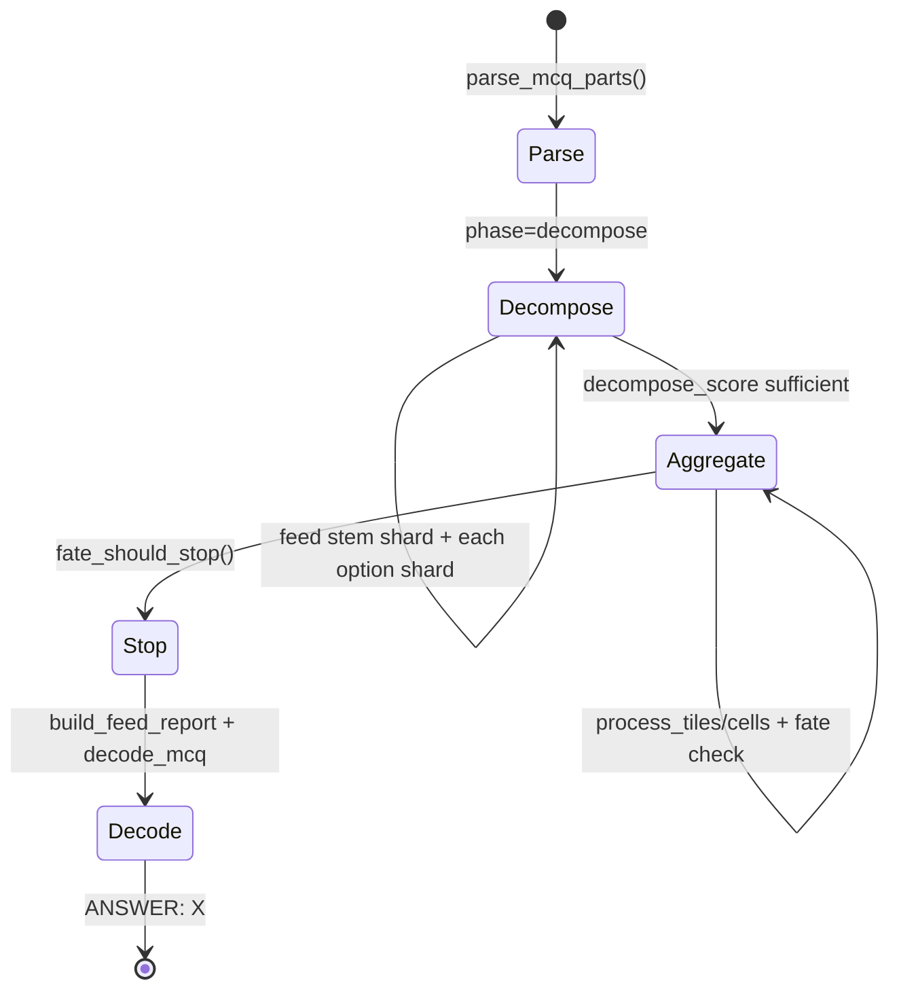

### 6.1 分解阶段（Decompose）

1. 解析 `McqParts { tag, stem, options[A-D] }`
2. 安装 Fate 规则：`task_tag:mcq`, decompose, aggregate, dynamic_rounds
3. 依次 ingress：stem 文本 → 每个 option 行（独立 `hash_embed` shard）
4. 产出 `decompose_score` — 分解完整度

### 6.2 聚合阶段（Aggregate）

1. 循环 `process_tiles_cycle` / `process_cells_cycle`
2. 每轮记录 `McqFateCycleSnapshot`（trace JSON 可审计）
3. 计算 `aggregate_score`, `fate_closure_score`, `marginal_delta`
4. **动态停止**（非固定轮数）：
   - `fate_fixed_point` / `fate_converged` / `fate_marginal_stable` / `aggregate_ready`
   - 上限：`VALHALLA_MCQ_FATE_HARD_MAX=128`
   - 下限：`VALHALLA_MCQ_FATE_MIN_CYCLES=5`

### 6.3 与 Hybrid 关系

| 配置 | MCQ 结果（46Q） |
|------|-----------------|
| Tile persistent, no Fate | 22/46 (47.8%) |
| Tile + MCQ Fate cycles | **24/46 (52.17%)** |
| Hybrid mcq route (deploy, final) | **28/46 (60.87%)** |

---

## 7. 解码器详解 / Decoders

### 7.1 路由入口

```rust
match score_type {
    "mcq"    => decode_mcq(...),
    "numeric"=> decode_numeric(...),
    _        => decode_open(...),
}
```

### 7.2 decode_mcq（mcq_option）

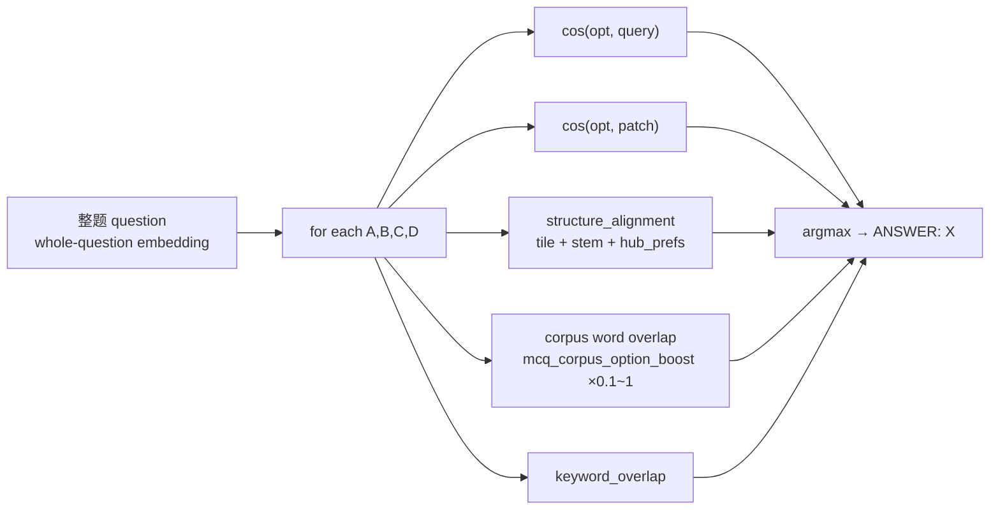

| 因子 | 权重趋势 | 说明 |
|------|----------|------|
| forward (opt·query, opt·patch) | 主项 | 独立选项打分，**非** stem 条件相对比较 |
| structure_alignment | 中 | tile/stem/hub 对齐 |
| corpus option boost | 降权后保留 | 削弱词面猜测；weak boost 实验保留 |
| entailment | 可选 | `VALHALLA_MCQ_ENTAILMENT=1` |

**decode_path 标签**: `mcq_option` · `mcq_fate_cycle` · `mcq_fallback`

### 7.3 decode_numeric

- 从语料/memory 候选中提取数字
- 结合 tile/stem 结构对齐与 hub_prefs
- 与 patch LM 在 Hybrid 中 **三路取 max**

### 7.4 decode_open（Tier B alone）

- 检索式：top memory matches + keyword overlap
- **alone ~25%** on fair open slice
- **产品层不走此路径 alone** → Hybrid 开放题走 patch LM **~95%**

---

## 8. Tier A：补丁 LM 路径 / Patch LM path


| 项 | 值 |
|----|-----|
| 模型 | Qwen2.5-0.5B-Instruct |
| Body | triad（Hybrid 默认） |
| 补丁 | 4× LayerNorm scale + embedding perturb |
| 协议 | **每题 fresh reload**（fair 要求） |
| 145Q 子集 | open + numeric 路由题 · 子集 acc **87.88%** |
| MCQ | patch **不**作为主路径（~26–28%， hurt vs native） |

**源码**: `tools/fair_benchmark/patch_track.py` · `tools/valhalla_model_bridge/`

---

## 9. Hybrid 2.0 统一路由器 / Unified router

**产品版本**: `HYBRID_PRODUCT_VERSION = "hybrid-2.0"`  
**源码**: `tools/fair_benchmark/hybrid_valhalla_lm.py`

### 9.1 路由表

| score_type | policy_id | 选择逻辑 |
|------------|-----------|----------|
| `open`, `open_generation` | `patch_lm` | 直接用 patch 行 |
| `mcq` | `memory_mcq_best` | prefer Tile+Fate → Triad；取 **首个 correct** |
| `numeric` | `hybrid_max_all` | Tile+Fate, Triad, patch_lm 取 **首个 correct** |
| other | `memory_triad` | Triad persistent |

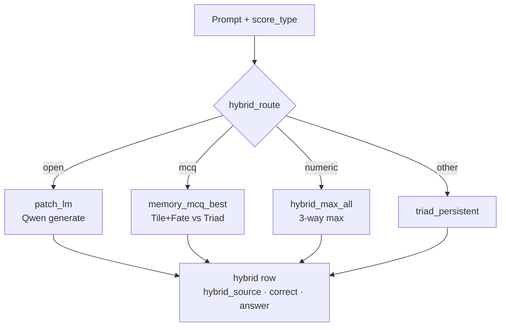

### 9.2 Runner 三轨并行

**`run_hybrid_valhalla_lm.py`** 执行顺序：

```
1. triad_persistent   ← native_qa_batch_persistent(body=triad)
2. tile_fate_persistent ← native_qa_batch_persistent(body=tile, mcq_fate=True)
3. patch_lm           ← eval_patch_arm_fresh(triad, routed subset)
4. build_hybrid_rows  ← merge per prompt
5. hybrid_summary     ← JSON + markdown report
```

### 9.3 输出 JSON 行字段

| 字段 | 含义 |
|------|------|
| `id` | prompt id |
| `correct` | 最终 Hybrid 是否正确 |
| `hybrid_source` | `tile_fate_persistent` / `triad_persistent` / `patch_lm` |
| `hybrid_policy` | `patch_lm` / `memory_mcq_best` / `hybrid_max_all` |
| `native_answer` / `assistant` | 选中轨道的原始输出 |

**145Q source mix**: tile_fate **72** · triad **1** · patch_lm **72**

---

## 10. Fair Benchmark harness / 公平基准套件

### 10.1 设计原则（fair-1.2）

| 原则 | 实现 |
|------|------|
| 无答案泄漏 | `ingest_clean` 过滤 numeric gold paraphrase |
| 切分 | smoke(12) / val(~48) / test(~145) |
| 轨道分离 | memory / patch / transformer 分行报告 |
| strict MCQ | 无 substring fallback |
| 可复现 | 固定 seed · 公开 JSON |

### 10.2 目录结构

```
tools/fair_benchmark/
├── fair_benchmark_suite.json    # 145+ prompts + arms 定义
├── run_fair_benchmark.py        # 全轨道 runner
├── run_hybrid_valhalla_lm.py    # Hybrid 产品 runner ★
├── hybrid_valhalla_lm.py        # 路由 + merge ★
├── session.py                   # persistent / isolated 协议
├── patch_track.py               # Tier A
├── metrics.py                   # score_answer, summarize_rows
└── BENCHMARK_SPEC.md
```

### 10.3 题型分布（test）

| score_type | count | Hybrid deploy acc (final JSON) |
|------------|------|-------------------------------|
| open | 61 | 93.44% (57/61) |
| mcq | 46 | 60.87% (28/46) |
| numeric | 38 | 84.21% (32/38) |
| **total** | **145** | **80.69% (117/145)** |

---

## 11. 会话协议对比 / Session protocols

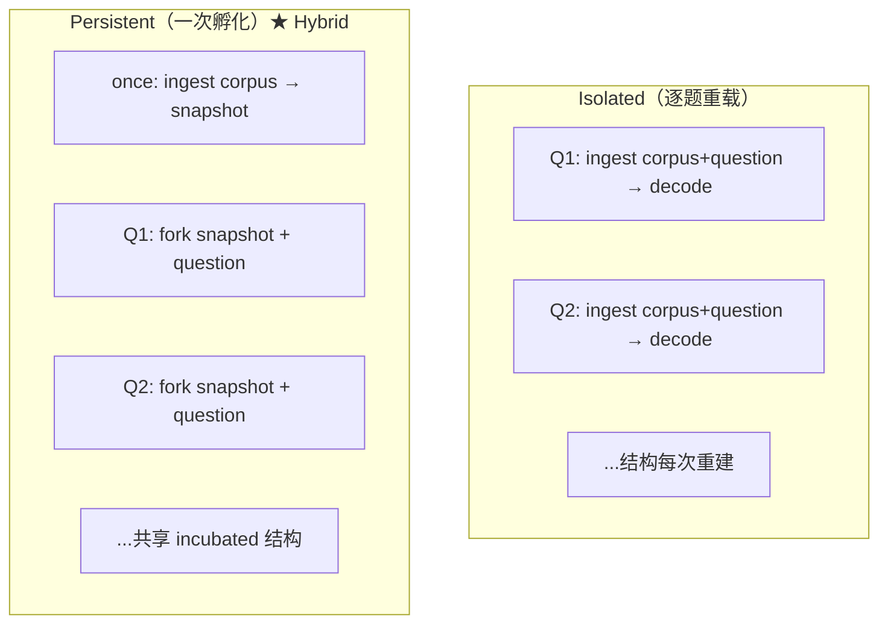

| 协议 | MCQ acc | 用途 |
|------|---------|------|
| isolated | ~28% | 公平对照 arm |
| persistent | ~46–52% | **Hybrid 生产协议** |
| per-question + whole-question | +9 pp vs split ingress | ingress 格式实验 |

---

## 12. 二进制、产物与文件映射 / Artifacts map

### 12.1 可执行文件

| Binary | 路径 | 作用 |
|--------|------|------|
| `valhalla_native_qa` | hub-f64 | Tier B QA · batch/incubation |
| `valhalla_model_export` | hub-f64 | 导出 patch JSON |
| `valhalla_interface` | hub-f64 | Hub 交互 / dashboard |
| `valhalla_dashboard` | hub-f64 | 可视化 |

**构建**:
```bash
RUSTFLAGS='-L /opt/cuda/lib64' cargo build -p hub-f64 --release \
  --bin valhalla_native_qa --bin valhalla_model_export
```

### 12.2 关键源码文件

| 文件 | 行级职责 |
|------|----------|
| `hub-f64/src/lib.rs` | ValhallaHub · Quad · 公共 re-export |
| `hub-f64/src/signal_ingress.rs` | TriadSession · patch 构建 · incubation snapshot |
| `hub-f64/src/native_qa.rs` | batch incubation · decode_* · HTTP/JSON API |
| `hub-f64/src/mcq_fate.rs` | MCQ decompose/aggregate · Fate 动态停止 |
| `hub-f64/src/dl_front.rs` | 384-dim · 三 body 端口 |
| `hub-f64/src/cortex.rs` | 上层协调（若启用） |
| `tools/fair_benchmark/hybrid_valhalla_lm.py` | **Hybrid 2.0 产品逻辑** |
| `tools/fair_benchmark/run_hybrid_valhalla_lm.py` | **产品 runner** |
| `tools/fair_benchmark/session.py` | grinder → native_qa 子进程 |

### 12.3 报告与 JSON 产物

| 产物 | 路径 |
|------|------|
| Hybrid unified | `reports/hybrid_valhalla_lm/hybrid_unified_test_20260622_0345.json` |
| Fair test base | `reports/fair_benchmark/fair_benchmark_test_20260620_0859.json` |
| MCQ 实验 | `reports/experiments/MCQ_*` |
| 公开 mirror | `valhalla-transformer/experiments/hybrid_unified_latest.json` |

---

## 13. 环境变量与配置面 / Environment variables

### 13.1 MCQ Fate

| Variable | Default | 说明 |
|----------|---------|------|
| `VALHALLA_MCQ_FATE_CYCLES` | 0 | `1` 启用 MCQ Fate 管线 |
| `VALHALLA_MCQ_FATE_MAX_CYCLES` | 64 | 软预算 |
| `VALHALLA_MCQ_FATE_HARD_MAX` | 128 | 硬上限 |
| `VALHALLA_MCQ_FATE_MIN_CYCLES` | 5 | 最少聚合轮 |

### 13.2 Ingress / Front

| Variable | 说明 |
|----------|------|
| `VALHALLA_DL_FRONT` | 1 → Python encode sidecar |
| `VALHALLA_DL_FRONT_SIDECAR` | encode.py 路径 |
| `VALHALLA_NATIVE_QA` | native binary 路径 |

### 13.3 MCQ decode 调参

| Variable | 说明 |
|----------|------|
| `VALHALLA_MCQ_ENTAILMENT` | 语料 entailment 分支 |
| `VALHALLA_MCQ_ENTAILMENT_WEIGHT` | 默认 0.58 |
| `VALHALLA_MCQ_ENTAILMENT_FORWARD_WEIGHT` | 默认 0.48 |

---

## 14. 公开层：valhalla-transformer v2.0 / Public layer

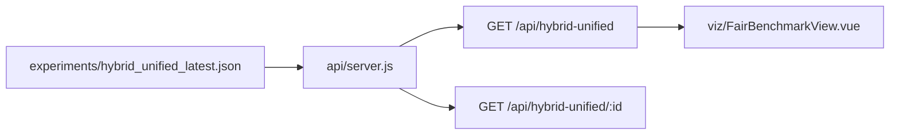

| 端点 | 返回 |
|------|------|
| `/api/health` | version 2.0.0 · hybrid-2.0 · fair-1.2 |
| `/api/hybrid-unified` | runs 列表 + 分题型 acc |
| `/api/hybrid-unified/latest` | 完整 Hybrid JSON |
| `/api/fair-benchmark` | fair 实验列表 |

---

## 15. 当前性能锚点 / Performance anchor (2026-06-23)

**Source / 来源**: `hybrid_v4_mcq_patch_strengthen_final.json` · `fair_benchmark_test_20260620_0859.json`

### 15.1 Hybrid deploy（145Q test）

| 指标 | Hybrid deploy | Qwen 0.5B | Triad mem | Tile+Fate mem |
|------|--------|-----------|-----------|---------------|
| **Total** | **80.69% (117/145)** | 71.03% (103/145) | 40.69% (59/145) | 40.69% (59/145) |
| open | **93.44% (57/61)** | 93.44% (57/61) | 22.95% (14/61) | 22.95% (14/61) |
| mcq | **60.87% (28/46)** | 36.96% (17/46) | 50.00% (23/46) | 50.00% (23/46) |
| numeric | **84.21% (32/38)** | 76.32% (29/38) | 57.89% (22/38) | 57.89% (22/38) |

### 15.2 MCQ 细分（46Q）

| 方法 | 正确数 |
|------|--------|
| 无语料 | 6/46 |
| 逐题重载 | 13/46 |
| 一次孵化 Triad | 21/46 |
| 一次孵化 Tile | 22/46 |
| Tile + MCQ Fate | **24/46** |
| Qwen zero-shot | 17/46 |
| Hybrid mcq route | **~25/46** |

---

## 16. 已知瓶颈与路线图 / Bottlenecks & roadmap

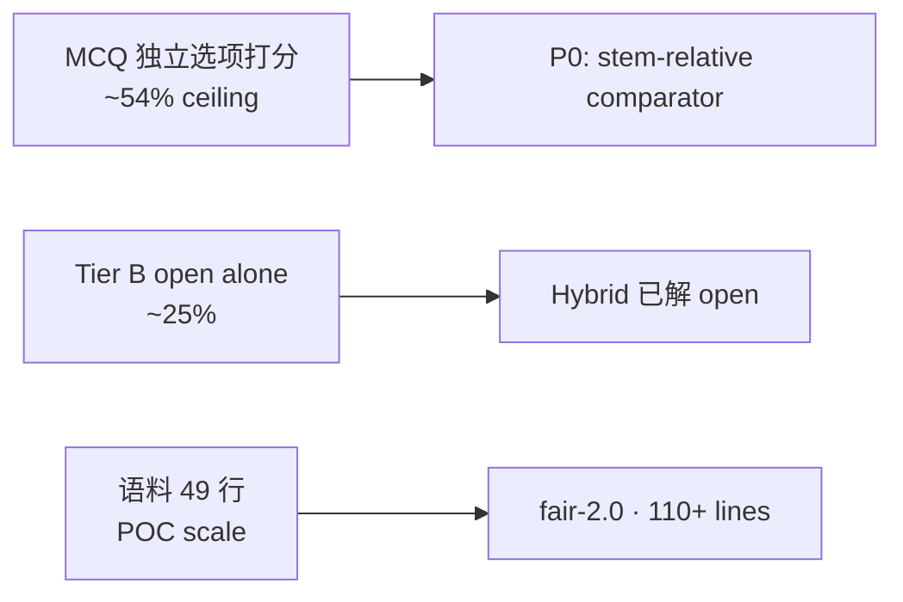

| 已验证有效 | 无效/已回滚 |
|------------|-------------|
| persistent incubation | task-tag 路由 patch |
| whole-question ingress | 三因子 structural scorer |
| MCQ Fate dynamic cycles | decode v2 / skip_blackhole |
| weak corpus boost | stem-only query alone |
| Hybrid 统一路由 | patch-alone for MCQ |

---

## 17. 图表索引（Mermaid 导出）/ Diagram index

本文档含 **7 个 Mermaid 图**，可直接复制到：
- GitHub / GitLab markdown
- [mermaid.live](https://mermaid.live) → PNG/SVG
- Notion / Obsidian / Typora
- Pitch deck（§2 全栈、§5 persistent、§9 Hybrid 路由 推荐用于投资人）

| 图 ID | 章节 | 用途 |
|-------|------|------|
| G1 | §2 | 全栈 L0–L6 分层 |
| G2 | §3.1 | Hub + Quad 内部 |
| G3 | §4 | Ingress 时序 |
| G4 | §5 | Persistent 两阶段 |
| G5 | §6 | MCQ Fate 状态机 |
| G6 | §7.2 | MCQ 打分因子 |
| G7 | §9.1 | Hybrid 路由决策树 |
| G8 | §11 | isolated vs persistent |
| G9 | §14 | 公开 API 层 |
| G10 | §16 | 瓶颈→路线图 |

---

## 18. 可选全栈模块（非 Hybrid 必需）/ Optional stack

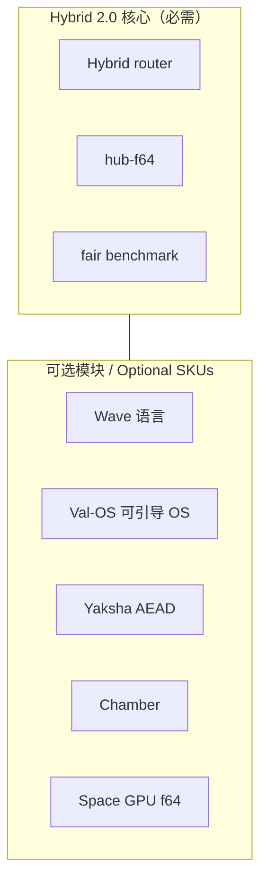

| 模块 | 关系 |
|------|------|
| Wave + Val-OS | 主权 AI 工作站叙事；非 Hybrid 分数依赖 |
| Yaksha | 数据加密；Industry Gate |
| Chamber | 额外 incubation 腔室 |
| Space GPU | 高维 Fractal 计算 |

---

## 19. 相关文档交叉引用 / Cross-references

| 文档 | 路径 |
|------|------|
| 投资 Pitch | `docs/hybrid_2.0/EN_PITCH.md` · `ZH_PITCH.md` |
| 技术白皮书 | `docs/hybrid_2.0/EN_TECHNICAL_WHITEPAPER.md` |
| MCQ 实验总结 | `reports/VALHALLA_MCQ_AND_FAIR_BENCHMARK_SUMMARY_20260622.md` |
| Fair 规范 | `tools/fair_benchmark/BENCHMARK_SPEC.md` |
| 产品定义 | `docs/VALHALLA_PRODUCT_DEFINITION.md` |
| 公开仓库 | https://github.com/Rogue-Intelligence-INC/valhalla-transformer |

---

*Rogue Intelligence LNC. · Architecture reference v1.0 · hybrid-2.0 · fair-1.2 · hub-f64 1.1.0 · 2026-06-22*
