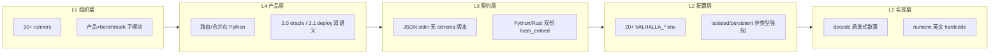
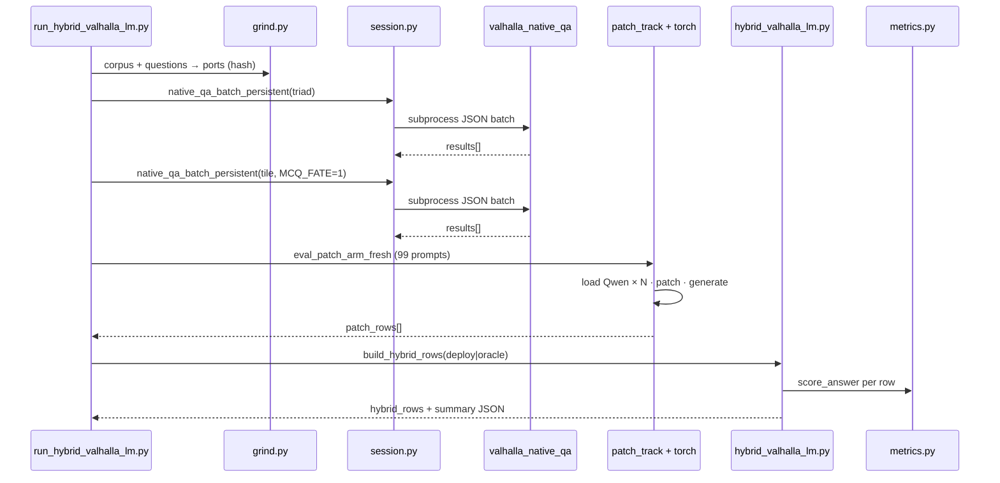
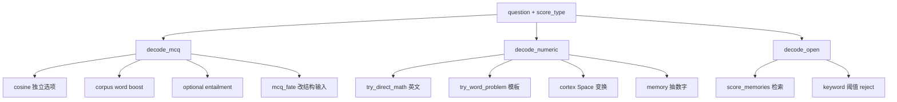
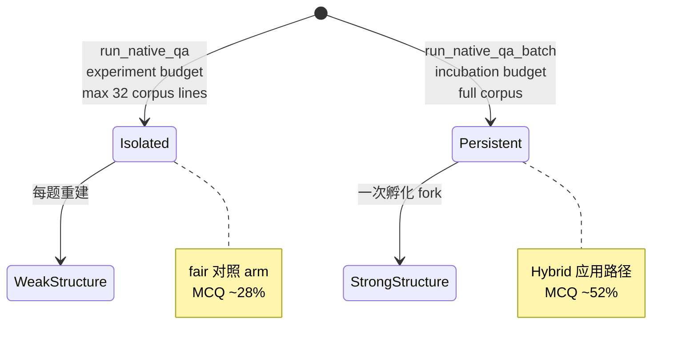
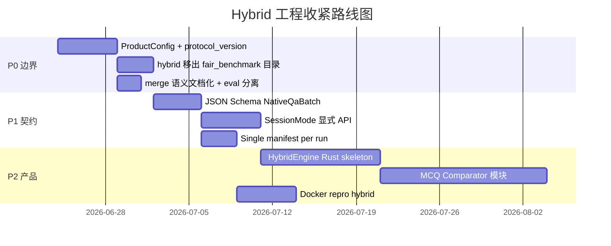

# Valhalla Hybrid — 内部工程化差距分析

**文档性质**：内部架构评审 · 非对外  
**日期**：2026-06-23  
**触发**：Hybrid 2.0→2.1 暴露「产品逻辑在 benchmark 脚本里、合并在 Python、Rust 只有 Tier B 碎片」  
**读者**：核心工程 · 用于决定下一版 **工程收紧** 的边界与优先级

---

## 0. 结论先行

当前系统 **能跑、能测、能出数**，但 **不是一颗紧耦合的产品工程**，而是：

> **Rust 结构运行时 + 多条 Python 实验流水线 + JSON 子进程胶水 + 评测 harness 兼当产品入口**

「松散」主要体现在五层：**组织边界、运行时契约、配置面、产品边界、观测与版本**。  
下图 §1 为 **现状 as-is**；§4 为 **建议 target**；§5–§8 为分项详解与改造清单。

---

## 1. 现状总图（As-Is · 松散耦合）

```mermaid
flowchart TB
  subgraph UserFacing["对外感知（松散）"]
    VT["valhalla-transformer<br/>静态 JSON + Node API"]
    DOCS["docs/hybrid_2.0<br/>Pitch / 白皮书 / 架构"]
    REPORTS["reports/*<br/>各实验各写 JSON/MD"]
  end

  subgraph ProductClaim["名义上的「产品」"]
    HY["hybrid_valhalla_lm.py<br/>★ 路由器 + 合并器"]
    RUN["run_hybrid_valhalla_lm.py<br/>★ 唯一产品 runner"]
  end

  subgraph BenchHarness["fair_benchmark/ · 30+ 脚本"]
    FB["run_fair_benchmark.py"]
    MCQ["run_mcq_* · run_tile_stem_*"]
    VPB["run_vpb_*"]
    SYNC["sync_*_to_valhalla_transformer.py"]
  end

  subgraph PyIslands["Python 工具岛 · 无统一 SDK"]
    SESS["session.py<br/>subprocess 调 Rust"]
    GRIND["transformer_grinder/"]
    BRIDGE["valhalla_model_bridge/"]
    TFA["tier_a_tf_front/pipeline.py"]
    PATCH["patch_track.py"]
  end

  subgraph RustCore["hub-f64 · Rust 唯一硬核"]
    NQA["valhalla_native_qa<br/>JSON stdin/stdout CLI"]
    EXPORT["valhalla_model_export"]
    LIB["lib: TriadSession · native_qa · mcq_fate"]
  end

  subgraph External["外部依赖"]
    HF["HuggingFace Qwen<br/>torch · 每题 reload"]
  end

  RUN --> HY
  RUN --> SESS
  RUN --> PATCH
  SESS -->|"JSON pipe"| NQA
  PATCH --> TFA --> HF
  PATCH --> BRIDGE
  SESS --> GRIND
  NQA --> LIB

  FB --> SESS
  MCQ --> SESS
  VPB --> SESS
  RUN -.->|"同目录混放"| FB

  HY --> REPORTS
  RUN --> REPORTS
  SYNC --> VT
  DOCS -.->|"描述 ≠ 代码边界"| HY

  style ProductClaim fill:#3d2a1a,stroke:#f90
  style BenchHarness fill:#2a2a3d,stroke:#99f
  style PyIslands fill:#1a2a2a,stroke:#6cc
```



### 1.1 一张图读懂「松散」

| 视觉区域 | 问题 |
|----------|------|
| **ProductClaim 只有 2 个 .py** | 整个 Hybrid 产品 = 评测目录里的模块，无 crate / 无 package |
| **BenchHarness 30+ 脚本** | 实验与产品同目录、同 import 路径，边界模糊 |
| **PyIslands 四座岛** | grinder / bridge / tf_front / fair_benchmark 各管一段，无 `valhalla_product` 包 |
| **Rust 只有 CLI** | 无 `HybridEngine`；Python 子进程拼 JSON |
| **VT 读静态 JSON** | 公开层不是 live product，是 report sync |

---

## 2. 分层问题模型



---

## 3. 数据流现状（一次 Hybrid test 实际路径）



**工程问题**：
- 同一 145 题 **Rust 跑 2 遍 full batch**（triad + tile），**Python 跑 up to 99 遍 HF reload**
- **Grinder 在 Python 预算**，Rust `mcq_fate` 里又有一套 `hash_embed`
- **合并在第三步**，Rust 从未见过 Hybrid 概念

---

## 4. 目标形态（To-Be · 工程收紧）

```mermaid
flowchart TB
  subgraph ProductCrate["hub-f64 或 valhalla-product crate"]
    CFG["ProductConfig<br/>单 struct · 无散落 env"]
    ENG["HybridEngine"]
    RT["RoutePolicy · deploy"]
    MEM["MemoryTrack · persistent"]
    TIERA["PatchTrack · optional feature"]
    DEC["DecoderRegistry<br/>open/mcq/numeric"]
  end

  subgraph SingleCLI["单一入口"]
    CLI["valhalla_hybrid<br/>ask · batch · eval"]
  end

  subgraph BenchThin["fair_benchmark · 薄 harness"]
    SPEC["suite.json + metrics"]
    RUNNER["调用 ProductEngine.eval()"]
  end

  subgraph Schema["契约"]
    IDL["JSON Schema / protobuf<br/>CorpusSession · AskRequest · AskResponse"]
  end

  CLI --> ENG
  BenchThin --> ENG
  ENG --> CFG
  ENG --> MEM --> DEC
  ENG --> RT
  ENG --> TIERA
  ENG --> IDL

  style ProductCrate fill:#1a3d1a,stroke:#6f6
```



**原则**：
1. **产品逻辑进 Rust**（或单一 Python package `valhalla_product`，二选一，勿双轨）
2. **benchmark 只负责出题 + 计分**，不再持有 router
3. **配置一个 struct**，env 仅作 override
4. **契约版本化**（`protocol_version: 1`）

---

## 5. 分项详解：松散在哪里

### 5.1 组织边界 — 「实验仓库形态」

| 现象 | 位置 | 影响 |
|------|------|------|
| fair_benchmark 下 **30 个** `run_*.py` | `tools/fair_benchmark/` | 新人无法区分「产品路径」vs「一次性实验」 |
| Hybrid 产品代码在 benchmark 目录 | `hybrid_valhalla_lm.py` | 产品生命周期绑在评测工具上 |
| 三套 benchmark 并行 | fair / incubation / vpb | 指标、语料、split 规则三套，难统一 |
| 同步脚本分散 | `sync_hybrid_*` `sync_vpb_*` `sync_tile_*` | 公开仓库与主库靠手工 copy |
| 报告散落 | `reports/` 20+ 子目录 | 无 canonical artifact registry |

**应然**：`tools/valhalla_product/`（或 Rust crate）+ `tools/fair_benchmark/` 只 import 产品 API。

---

### 5.2 产品边界 — Hybrid 不是运行时实体

| 组件 | 现状 | 工程缺口 |
|------|------|----------|
| 路由器 | Python `hybrid_route()` | 无法在 Rust 服务 / WASM / 嵌入式复用 |
| 合并器 | Python `build_hybrid_rows()` | 2.0 oracle / 2.1 deploy 双语义，易误报分 |
| Tier B | Rust `run_native_qa_batch` | 无「Hybrid session」；batch 即 max 能力 |
| Tier A | Python `patch_track` | torch 硬依赖；与 Rust export 两条 export 路径 |
| 计分 | Python `metrics.py` | 与 Rust decode 分离；strict MCQ 规则两处要对齐 |

**症状**：对外说「一个 Hybrid 产品」，代码里 **没有名为 Hybrid 的 type**，只有 JSON 行上的 `hybrid_source` 字符串。

---

### 5.3 运行时契约 — 子进程 JSON 胶水

**native_qa 接口**（`valhalla_native_qa.rs` CLI）：

```
stdin:  NativeQaRequest | NativeQaBatchRequest (serde 推断)
stdout: NativeQaResponse | NativeQaBatchResponse
```

| 缺口 | 说明 |
|------|------|
| 无 `protocol_version` | 字段增删靠 serde default，Python 侧 silent break |
| `corpus_ports` 必须由 Python grinder 提供 | Rust 不能独立启动 persistent session |
| 双路径 ingest | `run_native_qa` isolated vs `run_native_qa_batch` 不同 budget/行数上限 |
| 错误处理 | subprocess `check=True`；Rust panic → Python 整轨失败 |
| 无 streaming / 无 partial | 145 题必须一次 batch JSON |

**Grinder 重复**：

| 实现 | 文件 |
|------|------|
| Python hash_embed | `transformer_grinder/grind.py` |
| Rust hash_embed | `dl_front.rs` · `mcq_fate.rs` |

同一算法两处维护，**漂移风险**。

---

### 5.4 配置面 — 环境变量丛林

**不完全统计（仅 hub-f64 相关）**：

| 变量 | 作用域 | 问题 |
|------|--------|------|
| `VALHALLA_MCQ_FATE_CYCLES` | MCQ Fate | runner 里临时 set/unset |
| `VALHALLA_MCQ_FATE_MAX/HARD/MIN` | Fate 停止 | 无文档单页 |
| `VALHALLA_MCQ_CORPUS_BOOST_*` | decode 权重 | Rust 内 env_f64 |
| `VALHALLA_MCQ_ENTAILMENT*` | decode 分支 | 默认 off |
| `VALHALLA_DL_FRONT*` | ingress | Python/Rust 各读 |
| `VALHALLA_GRINDER_SIGNALS_PER_PORT` | port 维度 | 别名重复 |
| `VALHALLA_NATIVE_MAX_CORPUS_LINES` | isolated 32 行 | 与 persistent 行为差 invisible |
| `VALHALLA_INGEST_ALL_CORPUS` | isolated 例外 | |
| `VALHALLA_HYBRID_MERGE_MODE` | Python merge | 非 Rust |
| `RUSTFLAGS` | 构建 | 调用方各自 set |

**应然**：`ProductConfig { ingress, mcq, fate, hybrid, patch }` + TOML/JSON 文件 + env 仅 overlay。

---

### 5.5 解码与策略 — 启发式堆叠、非模块注册



| 问题 | 详情 |
|------|------|
| 无 Decoder trait | 三种 decode 大函数，难单测、难 A/B |
| `decode_path: String` | 非 enum；summary 靠字符串聚合 |
| numeric 英文耦合 | `try_direct_math` / `try_word_problem` 不可 i18n |
| MCQ 无相对比较 | 架构瓶颈，代码结构也缺「Comparator 层」 |
| Fate 与 decode 脱节 | Fate 只改 patch 输入，不改比较逻辑 |

---

### 5.6 会话协议 — 两种人生



**工程缺口**：API 层不强制；同一 binary 两种语义，靠 JSON 字段 + 隐式 env 区分，**易误用**。

---

### 5.7 版本与观测 — 难审计

| 项 | 现状 |
|----|------|
| 产品版本 | Python 常量 `HYBRID_PRODUCT_VERSION` |
| hub 版本 | `Cargo.toml` 1.1.0 |
| fair 版本 | 另一常量 `FAIR_BENCHMARK_VERSION` |
| 公开 API | `valhalla-transformer` 2.0.0 独立 |
| 路由 trace | JSON 行 `hybrid_source`；无 OpenTelemetry / 无 struct log |
| 实验 reproducibility | 靠 JSON 文件 + 手工 md；无 run manifest hash |

一次 test 的 **真实配置** 分散在：env、CLI args、corpus 文件、artifact 路径、merge_mode——**无单一 manifest**。

---

### 5.8 依赖与部署 — 非单一 artifact

| 路径 | 依赖 |
|------|------|
| Tier B only | Rust binary + grinder Python |
| Hybrid deploy | + torch + CUDA + Qwen weights |
| Dashboard | axum + 可选 native_qa HTTP |
| VT viz | Node + 静态 JSON |

**无 Docker compose / 无 lock 住的三轨 repro 镜像** → 「能跑」依赖 Jouly 本机路径（如 `/opt/cuda/lib64`）。

---

## 6. 松散性矩阵（优先级）

| ID | 问题 | 严重度 | 改造难度 | 建议优先级 |
|----|------|--------|----------|------------|
| P0 | Hybrid 逻辑不在产品 crate | 高 | 中 | **P0** — `HybridEngine` in Rust 或 unified py package |
| P0 | oracle/deploy 双 merge 语义 | 高 | 低 | 默认 deploy；oracle 仅 `eval upper_bound` |
| P1 | subprocess JSON 无 schema 版本 | 高 | 低 | `protocol_version` + jsonschema test |
| P1 | 30+ runners 与产品混目录 | 中 | 中 | 目录重组 + `experiments/` archive |
| P1 | isolated/persistent 非显式 API | 高 | 中 | `SessionMode` enum 强制 |
| P2 | 双份 hash_embed | 中 | 中 | Rust 为 single source；Python 调 Rust 或 FFI |
| P2 | 20+ env 变量 | 中 | 中 | `ProductConfig` file |
| P2 | decode 大函数 | 中 | 高 | Decoder registry + MCQ Comparator |
| P3 | VT 静态 JSON | 低 | 低 | optional live hybrid endpoint |
| P3 | 报告散落 | 低 | 低 | `artifacts/manifest.jsonl` |

---

## 7. 建议工程化路线图（三阶段）



### Phase 0（1 周）— 不改算法，只收紧边界

1. 新建 `tools/valhalla_product/`：`router.py` `merge.py` `config.py` ← 从 fair_benchmark 迁出  
2. `fair_benchmark/run_hybrid_*.py` 变薄 wrapper  
3. 每次 run 写 `manifest.json`：git sha、config、binary path、corpus hash  
4. 文档：`INTERNAL_TECHNICAL_DECOMPOSITION.md` 链接本文件  

### Phase 1（2 周）— 契约

1. `schemas/native_qa_batch.v1.json` + CI 校验  
2. Rust `NativeQaBatchRequest { protocol_version, session_mode }`  
3. 禁止 isolated 默认跑 product eval（CLI guard）  

### Phase 2（1–2 月）— 产品实体

1. `valhalla_hybrid` binary：`valhalla_hybrid batch --config product.toml`  
2. Tier A 为 optional feature `patch-lm`  
3. MCQ `RelativeComparator` trait  

---

## 8. 目录重组建议（As-Is → To-Be）

```
As-Is                              To-Be
─────────────────────────────────────────────────────────
tools/fair_benchmark/              tools/fair_benchmark/
  hybrid_valhalla_lm.py      →       (thin) run_hybrid_eval.py
  run_hybrid_*.py                    eval.py → imports valhalla_product
  run_mcq_*.py               →     experiments/mcq/  (archive)
  run_tile_stem_*.py         →     experiments/tile_stem/
  session.py                 →     tools/valhalla_product/runtime/native_cli.py
  metrics.py                 →     tools/valhalla_product/metrics.py

manifestsys/hub-f64/               manifestsys/hub-f64/
  native_qa.rs               →       + hybrid/ mod (Phase 2)
  bin/valhalla_native_qa.rs  →       bin/valhalla_hybrid.rs (Phase 2)

reports/**                   →     artifacts/runs/<run_id>/
                                     manifest.json
                                     hybrid.json
```

---

## 9. 与 Hybrid 2.1 的关系

| 2.1 改进 | 工程化评价 |
|----------|------------|
| deploy merge 去 oracle | ✅ 正确方向；但仍只在 Python |
| `score_answer` 重算 correct | ✅ 计分一致 |
| `--merge-mode` | ✅ 显式；应进 ProductConfig |
| numeric_confidence 路由 | ✅ 可部署；规则仍在 Python 字符串 |

**2.1 是「语义修正」，不是「结构收紧」**。本文档描述的是 **下一层：把修正后的语义写进产品边界**。

---

## 10. 附录：关键文件地图（现状）

| 职责 | 文件 | 层 |
|------|------|-----|
| Hybrid 路由/合并 | `tools/fair_benchmark/hybrid_valhalla_lm.py` | 产品（错位） |
| Hybrid runner | `tools/fair_benchmark/run_hybrid_valhalla_lm.py` | 产品入口（错位） |
| Native 子进程 | `tools/fair_benchmark/session.py` | 胶水 |
| Grinder | `tools/transformer_grinder/grind.py` | ingress |
| Patch 评测 | `tools/fair_benchmark/patch_track.py` | Tier A |
| Patch 施加 | `tools/tier_a_tf_front/pipeline.py` | Tier A |
| Rust batch | `native_qa.rs:run_native_qa_batch` | Tier B |
| Rust isolated | `native_qa.rs:run_native_qa` | Tier B（易误用） |
| MCQ Fate | `mcq_fate.rs` | Tier B |
| 计分 | `tools/fair_benchmark/metrics.py` | harness |
| 内部技术分解 | `docs/hybrid_2.0/INTERNAL_TECHNICAL_DECOMPOSITION.md` | 文档 |
| 2.1 对比 | `reports/hybrid_valhalla_lm/HYBRID_2.1_DEPLOY_vs_ORACLE_20260623.md` | 报告 |

---

## 11. 图表索引

| 图 | 章节 | 用途 |
|----|------|------|
| G1 | §1 | **现状 as-is** 组织松散总图 |
| G2 | §2 | 五层问题模型 |
| G3 | §3 | Hybrid test 时序（真实调用链） |
| G4 | §4 | **目标 to-be** 收紧架构 |
| G5 | §5.5 | decode 启发式堆叠 |
| G6 | §5.6 | isolated vs persistent |
| G7 | §7 | 路线图 Gantt |

导出：复制 Mermaid 至 [mermaid.live](https://mermaid.live) → PNG/SVG 用于内部分享。

---

*内部工程化差距分析 v1.0 · Rogue Intelligence LNC. · 2026-06-23*
