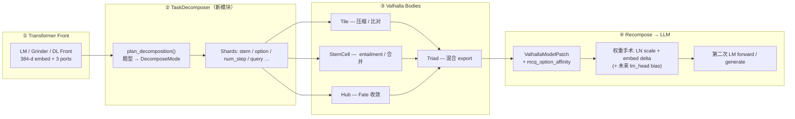

# Pipeline v4 — LM 分解 → Valhalla → 回写 Transformer

**版本**: `pipeline-v4-decompose` · **日期**: 2026-06-23  
**动机**: MCQ ~52% 暴露架构粗糙 — 题型各自为政，缺少 **LM ↔ Valhalla ↔ LM** 闭环

---

## 0. 问题诊断（为何 MCQ 低）

| 现状 | 问题 |
|------|------|
| MCQ 只走 Tier B memory（tile_fate + triad） | 无 patch LM 参与；纯结构启发式选 letter |
| `mcq_fate` 仅 MCQ 有 decompose | open/numeric 与 MCQ 分解逻辑不统一 |
| patch LM 对 open/numeric 有效 | MCQ 被 `hybrid_route` 硬路由到 memory |
| Valhalla 结构 → LLM | 只有 corpus incubation export；**单题分解结果不回写权重** |

> **根因**：分解发生在 Valhalla 内，但 **没有 recompose 回 transformer** 做 option logits / lm_head 偏置，MCQ 等于「结构猜字母」。

---

## 1. 目标管线（v4）



**原则**：

1. **所有题型**走同一骨架：Front → Decompose → Valhalla → Recompose → LLM  
2. **DecomposeMode** 按题型可插拔，不硬编码在 `mcq_fate` 里  
3. Valhalla 输出必须能 **修改 LLM**（legacy patch 已验证 open/numeric；MCQ 需 option affinity → lm_head）

---

## 2. 模块映射（已实现 scaffold）

| Rust 模块 | 职责 |
|-----------|------|
| `task_decompose.rs` | `TaskKind` · `DecomposeMode` · `DecomposePlan` · `RecomposePatch` |
| `pipeline.rs` | `run_question_pipeline()` 编排单题全流程 |
| `mcq_fate.rs` | MCQ aggregate 引擎（逐步迁入 pipeline 子步骤） |
| `patch_export.rs` | corpus → `ValhallaModelPatch` |
| `patch_lm.rs` | recompose patch → Qwen 权重 + generate |
| `hybrid.rs` | 多轨合并（v4 完成后 MCQ 可走 patch+memory 双路） |

### 2.1 DecomposeMode 一览

| 题型 | 默认 Mode | Shards |
|------|-----------|--------|
| **mcq** | `McqStemOptions` | `MCQ_STEM` + `MCQ_OPTION_*` + `MCQ_AGGREGATE` |
| mcq (alt) | `McqPairwiseCompare` | stem×option 配对 → Stem 摄入 |
| **numeric** | `NumericSteps` | `NUM_WHOLE` + 行级 `NUM_STEP` + `NUM_ANSWER_SLOT` |
| **open** | `Whole` / `OpenRetrieval` | 整题 或 query+recompose slot |

### 2.2 RecomposePatch（回写 LLM 的载体）

```rust
RecomposePatch {
  model_patch: ValhallaModelPatch,      // quad_scales + patch_vector
  patch_token_ids: Vec<u32>,            // anchor + shard 头 token
  lm_user_text: String,                 // 原始题面
  shard_scores: Vec<f64>,               // 各 shard 闭包分数
  mcq_option_affinity: Vec<(char,f64)>, // ★ MCQ: A–D 结构亲和度
}
```

**MCQ 提升路径（下一步实现）**：

1. `mcq_option_affinity` → **lm_head 行偏置**（每选项 token 一行加 bias）  
2. 或 → **第二次 generate**，prompt 末尾注入 `ANSWER: {letter}` 约束  
3. hybrid deploy：`max(memory_mcq, patch_mcq)` 而非 memory-only

---

## 3. 与 Hybrid 路由的关系

### 现状 (3.1)

```
open      → patch_lm
numeric   → numeric_confidence (memory 高置信 else patch)
mcq       → memory_mcq_best ONLY   ← 瓶颈
```

### 目标 (4.0)

```
all types → pipeline_v4(question)
              ├─ Tier B: decode from recompose (MCQ affinity / numeric slot)
              └─ Tier A: patch_lm(recompose.patch) + generate
merge:
  mcq       → max(deploy_memory, deploy_patch_mcq)
  numeric   → numeric_confidence (unchanged logic, better patch)
  open      → patch_lm (unchanged)
```

---

## 4. 实施阶段

| 阶段 | 内容 | MCQ 预期 |
|------|------|----------|
| **P0** ✅ | `task_decompose` + `pipeline` scaffold + 本文档 | 架构就绪 |
| **P1** | `native_qa` / `hybrid` 调用 `run_question_pipeline`；MCQ decode 用 `decode_mcq_from_recompose` | +5–10pp |
| **P2** | `patch_lm` 应用 `mcq_option_affinity` → lm_head bias；MCQ 走 patch 轨 | +10–15pp |
| **P3** | `McqPairwiseCompare` + Stem entailment shards A/B test | 收敛到 70%+ |
| **P4** | DL Front 替代 hash grinder；分解在 embedding 空间 | 产品化 |

---

## 5. 启用与测试

```bash
# 单元测试
RUSTFLAGS='-L /opt/cuda/lib64' cargo test -p hub-f64 task_decompose --no-default-features

# 未来: hybrid v4
# VALHALLA_PIPELINE_V4=1 ./target/release/valhalla_hybrid --phase test --merge-mode deploy
```

**Env（规划）**：

| 变量 | 含义 |
|------|------|
| `VALHALLA_PIPELINE_V4` | 启用 pipeline 单题路径 |
| `VALHALLA_DECOMPOSE_MODE` | 覆盖默认 DecomposeMode |
| `VALHALLA_MCQ_PATCH` | MCQ 启用 patch_lm 第二遍 |

---

## 6. 代码入口

```
manifestsys/hub-f64/src/
  task_decompose.rs   ← ② 分解计划 + recompose 结构
  pipeline.rs         ← ①–④ 编排
  mcq_fate.rs         ← MCQ aggregate（将被 pipeline 调用）
  patch_lm.rs         ← ④ LLM 权重修改 + generate
  hybrid.rs           ← 产品 merge（待接 v4 MCQ 双轨）
```

---

## 7. 设计约束（S-wind 对齐）

- **无预设答案**：`mcq_option_affinity` 来自 Fate/tile/stem 闭包信号，非 gold label  
- **代数优先**：shard_scores / affinity 保持 f64 结构量，最后才转 decode  
- **穷尽**：DecomposeMode 可枚举扩展，Fate 决定 aggregate 停止，非固定轮数
