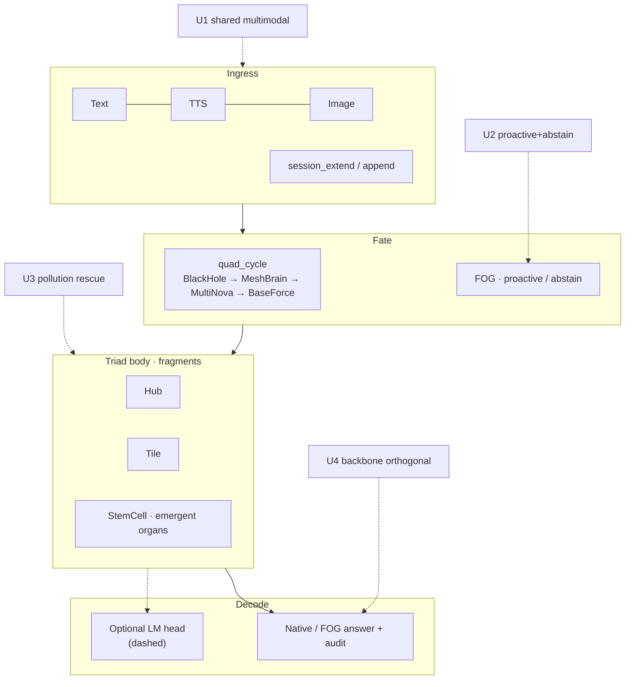

# ValhallaBase — product architecture (analysis + Pages)

**Visual (Pages):** [`../assets/architecture.svg`](../../valhalla-unified-core/assets/architecture.svg)  
**Live section:** Pages landing `#architecture`

This note is for your own stack analysis; the SVG is the public figure.

---

## Stack (top → bottom)

---

## Layers ↔ claims

| Layer | What it is | Proof / bound |
|-------|------------|---------------|
| Ingress | Multimodal into one session | U1 · mixed answer default |
| Fate | Scheduling + FOG | U2 · D1 quad vs semantic |
| Hub / Tile / Stem | Body under fragments | technical core · organ · topology |
| Native path | Structure answer (**answer_mix=mixed** by default) | continuity · mixed-answer proof |
| LM head | Optional, swappable | U4 · default 0.5B |
| U5 | Economics @ accuracy floor | Footnote until floor ≥0.80 |
| Longchain holdout QA | Absolute QA on protocol slice (n=3) | Cite with canonical legitimacy — ≠ industry LoCoMo |
| Interleave QA | Absolute QA under pollution | Boundary (75% developing; 1/4 residual) |

---

## What is *not* in the diagram (on purpose)

- Memory-API extract→vector→inject loop (peer category)  
- Preset organ nameplate  
- LoCoMo SOTA claim  

---

*Use the SVG on Pages; edit this file when the stack changes.*

Also: [PROJECT_COMPLETENESS_20260714.md](./PROJECT_COMPLETENESS_20260714.md) — runnable integrity vs open gaps.

