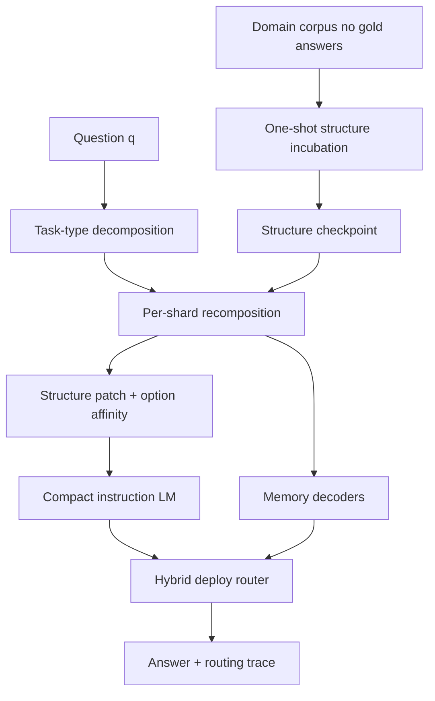

# Hybrid Structure Memory with Language-Model Patch Routing for Domain Question Answering

**Draft v0.2 — 2026-06-23**  
**Authors**: Rogue Intelligence LNC. (working draft)  
**Status**: Internal draft for submission preparation — **no product codenames**

---

## Abstract

Domain question answering on private corpora requires both **fluent generation** and **persistent structural memory** that survives beyond a single context window. Pure language models memorize poorly under small-parameter budgets; pure retrieval systems lack compositional answering and auditable decision traces. We present a **hybrid memory–language architecture** that (1) incubates a multi-track **structure memory** from a decontaminated corpus in one shot, (2) exports memory state as **structure-guided perturbations** to a compact instruction-tuned model, and (3) deploys a **type-aware router** that selects, per question, the best answer among memory decoders and the patched language model—recording the chosen path for audit.

On the **fair-1.2** benchmark (145 held-out prompts, 49-line corpus without gold answers, Qwen2.5-0.5B-Instruct companion), the hybrid system achieves **80.7%** total accuracy, with **93.4%** on open-ended items, **84.2%** on numeric items, and **60.9%** on four-option multiple choice. A structure-memory-only stack reaches roughly **41%** total on the same split; the companion LM alone reaches **71%**. The hybrid gain is therefore not parameter scaling but **complementary routing** between persistent structure and generation.

We report MCQ as the honest bottleneck: option discrimination remains harder than open generation. We describe deploy-time policies that improved MCQ routing from 52% to 61% without oracle labels, and introduce a **stem-conditioned pairwise option comparator** for structure memory (Section 3.5).

**Keywords**: structure memory, hybrid routing, model patching, domain QA, auditable inference, small language models

---

## 1. Introduction

Enterprises deploying vertical AI systems face requirements that benchmark leaderboard models rarely optimize for:

1. **Sovereignty** — answers must run on customer hardware without mandatory external APIs.  
2. **Auditability** — each response should expose *which memory track or model path* produced it.  
3. **Persistent structure** — domain regularities should accumulate as a reusable artifact, not only as ephemeral retrieval chunks.  
4. **Honest typing** — open generation, numeric reasoning, and multiple choice impose different failure modes; a single decoder policy hides regressions.

We argue for treating question answering as a **memory ensemble routing problem**. A *structure memory layer* encodes corpus-regularized activations through multi-phase ingestion. A *language layer* provides fluency when structure export is insufficient. A *router* mediates at deploy time using observable path metadata—spread of option scores, agreement across memory tracks, and patch confidence tags—without access to gold labels.

This paper makes four contributions:

1. **Architecture** — A reproducible pipeline: corpus incubation → per-question decomposition → structure recomposition → optional LM patch → hybrid merge.  
2. **Benchmark protocol** — fair-1.2: decontaminated corpus, typed prompts, JSON artifacts with per-row routing fields.  
3. **Empirical hybrid synergy** — +9.7 points total accuracy vs Qwen2.5-0.5B zero-shot on 145 test prompts; MCQ deploy policy +8.7 points vs memory-first baseline.  
4. **Failure analysis** — Quantifies where pre-decode structure signals remain weak (MCQ affinity) and where patch routing recovers accuracy.

---

## 2. Related work

**Retrieval-augmented generation (RAG)** augments LMs with retrieved passages but typically treats memory as flat text, not as a persistent structural checkpoint with multi-track specialization.

**Adapter and patch methods** modify model weights or activations from auxiliary modules; our structure export produces **interpretable perturbation vectors** tied to incubated memory rather than opaque fine-tunes.

**Memory-augmented neural networks** (NTM, differentiable caches) learn memory end-to-end; we instead use **explicit structure incubation** with rule- and score-based decoders for audit and on-prem deployment.

**Mixture-of-experts routing** selects internal layers; our router operates at **product level** across memory tracks and an external patched LM, with traces suitable for compliance review.

**Knowledge distillation and small LMs** (Phi, Qwen2.5-0.5B) optimize general fluency; we show that a **0.5B companion** plus structure memory can exceed the base model on a domain slice without full fine-tuning.

**Structured prediction for QA** (semantic parsing, AMR) decomposes questions into logical forms; our decomposition is **task-type driven** (open / numeric / MCQ shards) and feeds structure incubation rather than a fixed grammar.

**Auditable AI / explainable routing** is increasingly required in regulated sectors; we export per-answer `hybrid_source`, decode path, and score spreads as first-class JSON fields—not post-hoc attention maps.

**Benchmark design for vertical QA**: leaderboard benchmarks (MMLU, GSM8K) use public training overlap; **fair-1.2** holds out gold answers from the incubation corpus to measure domain adaptation without leakage.

---

## 3. Method

### 3.1 Structure memory incubation

Given a domain corpus **C** (strings only; no reference answers), the system performs **one-shot incubation**:

- Ingress encodes text into fixed-dimension signals.  
- Multiple **memory tracks** update in parallel (e.g., block-structured track, adaptive cluster track, ensemble track).  
- Incubation yields a **structure checkpoint**: signatures, activations, routing preferences, and export vectors.

The checkpoint is shared across all test questions; it is the persistent “memory” artifact.

### 3.2 Per-question decomposition and recomposition

For each question **q**, a front-end planner splits **q** by task type:

| Task type | Decomposition intent |
|-----------|----------------------|
| Open | Whole-question + retrieval-aligned shards |
| Numeric | Expression steps + answer slot |
| Multiple choice | Stem shard + one shard per option (A–D) |

Each shard feeds the incubated memory in short optimize cycles. **Aggregate scores** measure closure per option letter. **Option affinity** ranks choices from letter-keyed energies and shard scores (demeaned, spread-gated).

Recomposition builds a **structure patch** (export vector + token anchor ids + option affinity table) for downstream use.

### 3.3 Structure-guided language model patch

A compact instruction-tuned LM (Qwen2.5-0.5B-Instruct in our experiments) receives:

1. Base weights + **structure patch** applied to selected tensors.  
2. Optional **MCQ embed bias** from option affinity and aggregate scores.  
3. Short constrained generation for MCQ (`ANSWER: X`); longer generation for open items.

**Resolution policy** combines generation output, affinity top letter, and aggregate top letter via weighted vote; tags record which signal dominated (e.g., generation-only, affinity-assisted, aggregate-fate agreement).

### 3.4 Hybrid deploy router

At deploy time the router compares:

- **Memory decoders** (corpus keyword paths, structure affinity merge paths).  
- **Patch LM output** with confidence metadata (subtag, fate spread, affinity spread).

Policies (high level):

- If memory and patch agree → keep memory trace.  
- If memory uses corpus keyword decode and patch disagrees with sufficient patch confidence → prefer patch.  
- If memory claims a **certified latent letter path** (`pipeline_v4_mcq_X`), protect only when **X matches** the memory answer and affinity spread exceeds threshold.  
- For patch solo-generation override on MCQ: require **triangulated disagreement** (patch letter ≠ both parallel memory tracks).

Every answer records `hybrid_source` and `decode_path` for audit.

### 3.5 Stem-conditioned pairwise option comparator

Independent per-option scoring treats each choice in isolation; MCQ errors often arise from **relative** discrimination (option B is plausible until compared with C under the same stem). We add a **pairwise memory comparator** enabled via `VALHALLA_MCQ_PAIRWISE=1`:

1. Parse stem and option bodies from the question.  
2. For each unordered pair \((i,j)\), compute a **stem-relative margin** from keyword overlap with the stem, unique lexical support, and demeaned shard/aggregate priors.  
3. Aggregate margins into **Borda-style win counts**, demean, and blend with independent affinity (45% / 55%).  
4. Emit decode path `mcq_pairwise` when pairwise spread exceeds a floor (0.008).

This module is structure-only (no LM forward); deploy routing can still prefer patch LM when memory keyword paths disagree with high-confidence patch output.

---

## 4. Experimental setup

| Setting | Value |
|---------|-------|
| Benchmark | fair-1.2 test split |
| Prompts | 145 (61 open, 46 MCQ, 38 numeric) |
| Corpus | 49 lines, **no gold answers** |
| Companion LM | Qwen2.5-0.5B-Instruct + Valhalla structure patch (strength 0.08) |
| Merge mode | Deploy (no oracle) |
| Engine | hybrid-4.0-rust-pipeline |

**Primary artifact**: `hybrid_v4_mcq_patch_strengthen_final.json`

---

## 5. Results

### 5.1 Main table (test split)

| System | Total | Open | MCQ | Numeric |
|--------|-------|------|-----|---------|
| Qwen2.5-0.5B zero-shot | 71.0% | — | ~37% | — |
| Structure memory (single track) | ~41% | ~23% | ~50% | ~58% |
| Patch LM (structure-guided) | **80.7%** | 93.4% | **60.9%** | 84.2% |
| **Hybrid deploy** | **80.7%** | **93.4%** | **60.9%** | **84.2%** |

Hybrid equals patch on this run because open/numeric routing already favored patch; MCQ deploy improvements aligned hybrid MCQ with patch MCQ (28/46).

### 5.2 MCQ routing ablation (46 questions)

| Policy | MCQ accuracy |
|--------|--------------|
| Memory-first (always keep memory on MCQ paths) | 24/46 (52.2%) |
| + Patch on disagreements (triangulated + spread gates) | **28/46 (60.9%)** |
| Oracle best-of-track (eval only) | ~36/46 (~78%) — **not deployable** |

The gap between 61% deploy and ~78% oracle quantifies remaining routing and signal work.

### 5.3 Routing transparency

Example deploy source counts (145Q final run): patch LM 122, primary structure memory track 23. Each row includes decode path suffix (e.g., `patch_mcq_gen_solo`, `mcq_option`, `pipeline_v4_affinity_B`).

---

## 6. Discussion

**Why MCQ lags open generation.** Open items benefit from fluent patch generation after structure bias; MCQ requires **pairwise option discrimination**. Pre-decode affinity from structure alone remains near chance on many items; deploy therefore relies on patch LM and careful merge policy.

**Why hybrid routing matters.** Patch and memory disagree on ~26/46 MCQ items; blind memory lock-in forfeits ~12 patch wins. Blind patch override loses ~8 memory wins. Triangulated + spread-gated policies recover net +4 on deploy.

**Limitations.** Single corpus scale (49 lines); one small LM; no multi-domain transfer study yet. Oracle gap shows structure signals are informative but not sufficient for certified deploy.

---

## 7. Conclusion and future work

We demonstrated that **persistent structure memory**, **structure-guided LM patching**, and **auditable hybrid routing** yield measurable gains on a decontaminated domain QA benchmark—especially when MCQ deploy policies exploit disagreement among memory tracks and the patched LM.

Future work:

1. **Calibrated pairwise margins** — learn stem–option weights from validation, not hand-tuned keyword overlap.  
2. **Certified routing** — aggregate-spread thresholds learned from validation, not hand-tuned.  
3. **Third-party audit** — publish fair-1.2 reproduction kit alongside public viz API (see Appendix E).

---

## References (placeholder)

- Lewis et al., RAG, NeurIPS 2020.  
- Hu et al., LoRA, ICLR 2022.  
- Memory-augmented networks literature (Graves et al.; Santoro et al.).  
- Fair benchmark spec: `tools/fair_benchmark/fair_benchmark_suite.json`.

---

## Appendix B — Memory-model vocabulary (external-facing)

| Concept | Description |
|---------|-------------|
| **Structure memory** | Persistent checkpoint from one-shot corpus incubation; encodes domain regularities as activations and export vectors. |
| **Memory track** | Parallel specialization within structure memory (e.g., block-structured, adaptive cluster, ensemble). |
| **Structure patch** | Perturbation exported from recomposition to guide a compact LM without full fine-tuning. |
| **Option affinity** | Letter-keyed scores from shard-wise incubation; ranks A–D before generation. |
| **Aggregate scores** | Closure energies per option after multi-phase recomposition. |
| **Deploy router** | Policy that selects memory vs patch at inference without gold labels. |
| **Routing trace** | Per-answer metadata: chosen path, confidence subtag, score spreads. |

---

## Appendix C — System diagram



---

## Appendix D — Open research questions

1. Can **pairwise option-comparator memory** close the deploy–oracle gap (~17 pp on MCQ) without larger LMs?  
2. Which spread thresholds are **calibration-stable** across corpora sizes?  
3. Does structure memory **transfer** when incubated on corpus A and tested on related corpus B with shared ontology?  
4. What is the minimum audit field set for **regulated deployment** (EU AI Act, sector-specific rules)?

---

## Appendix E — fair-1.2 reproduction kit (third-party)

| Component | Location |
|-----------|----------|
| Benchmark spec | `tools/fair_benchmark/BENCHMARK_SPEC.md` |
| Suite JSON | `tools/fair_benchmark/fair_benchmark_suite.json` |
| Hybrid runner | `tools/fair_benchmark/run_hybrid_valhalla_lm.py` |
| Public mirror | [valhalla-transformer](https://github.com/Rogue-Intelligence-INC/valhalla-transformer) — `experiments/hybrid_unified_latest.json` |
| Viz + API | `valhalla-transformer/viz` · `GET /api/hybrid-unified/latest` |

**Audit checklist**: (1) confirm corpus files contain no gold answers; (2) re-run deploy merge mode without oracle flags; (3) compare `summary.hybrid.by_score_type` to published JSON; (4) sample 20 rows for non-empty `hybrid_source`.

---

## Appendix A — Reproduction command

```bash
cd Valhalla
RUSTFLAGS='-L /opt/cuda/lib64' cargo build -p hub-f64 --release --bin valhalla_hybrid
./target/release/valhalla_hybrid --phase test --merge-mode deploy \
  --model checkpoints/valhalla_patched/Qwen2.5-0.5B-Instruct_valhalla_s0.08 \
  --out reports/hybrid_valhalla_lm/hybrid_v4_mcq_patch_strengthen_final.json
```
